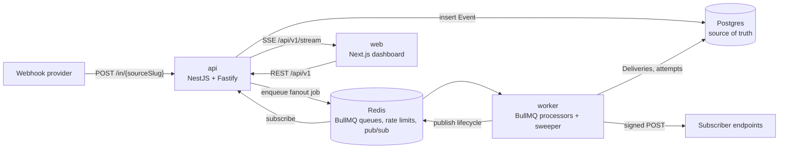

# hookdeck-lite

An open-source, self-hostable webhook gateway. Point your providers at it, and it verifies each webhook,
acknowledges it in milliseconds, then filters, routes, delivers, retries, and replays it to your endpoints.
A dashboard shows every event and delivery attempt live.

> Status: in development. This README is a skeleton. Day 4 of [the plan](docs/PLAN.md) finalizes it.

## Features

- **Fast, durable ingestion.** `POST /in/{sourceSlug}` verifies the signature, stores the event in Postgres,
  and returns `202`. A sweeper recovers events if the queue was unreachable.
- **Signature verification.** Standard Webhooks, generic HMAC-SHA256 with a configurable header, or none.
- **Routing with filters.** One event fans out to every matching connection. Filters are a small JSON DSL.
- **Reliable delivery.** At-least-once, exponential backoff with full jitter, `Retry-After` support,
  and a stable `webhook-id` so receivers can deduplicate.
- **Dead letters and replay.** Exhausted deliveries become `DEAD`. Replay one, or all for a destination.
  Replay never rewrites history.
- **Signed outbound requests** following the Standard Webhooks spec.
- **SSRF protection** with DNS resolution checks and IP pinning.
- **Per-tenant rate limiting** with an atomic Redis Lua script.
- **Live dashboard** over Server-Sent Events: events, attempts timeline, metrics, replay, filter tester.

## Architecture



Details: [docs/ARCHITECTURE.md](docs/ARCHITECTURE.md).

## Quickstart

Placeholder. Day 4 fills this in with the exact commands: clone, `docker compose up`, migrate, seed,
open the dashboard, and send a test webhook.

## Performance

Placeholder. Day 4 records the ingestion ACK latency (p50 / p95 / p99) measured by `tools/loadtest`,
with the machine and conditions. The target is p95 < 20 ms. See [docs/PRD.md](docs/PRD.md#non-functional-requirements).

## Documentation

| Read this | To learn |
|---|---|
| [docs/README.md](docs/README.md) | The map of every document |
| [docs/PRD.md](docs/PRD.md) | What the product does and what it does not |
| [docs/ARCHITECTURE.md](docs/ARCHITECTURE.md) | Components, sequence diagrams, failure modes |
| [docs/DATA-MODEL.md](docs/DATA-MODEL.md) | Schema, state machines, metrics queries |
| [docs/QUEUES.md](docs/QUEUES.md) | Queues, retries, backoff, shutdown |
| [docs/SECURITY.md](docs/SECURITY.md) | Threat model, signatures, SSRF, rate limiting |
| [docs/FILTER-RULES.md](docs/FILTER-RULES.md) | The filter DSL |
| [docs/api/openapi.yaml](docs/api/openapi.yaml) | The HTTP API |
| [docs/adr/](docs/adr/) | Why each decision was made |
| [docs/learning/](docs/learning/) | Webhooks, BullMQ, reliability, and SSRF explained from scratch |
| [docs/TESTING.md](docs/TESTING.md) | Test strategy |
| [docs/PLAN.md](docs/PLAN.md) | The 4-day build plan |

## Repository layout

```
apps/api            NestJS on Fastify: ingestion, management REST API, SSE stream
apps/worker         Plain TypeScript + BullMQ: fan-out, delivery, sweeper
apps/web            Next.js dashboard
packages/shared     Browser-safe: types, Zod schemas, filter engine
packages/database   Prisma schema, migrations, seed, client
packages/core       Node-only: queues, backoff, HMAC, encryption, SSRF-safe HTTP client, rate limiter
tools/mock-receiver Configurable "chaos" endpoint for demos and tests
tools/loadtest      autocannon script for ingestion latency
docs/               Specs, ADRs, learning material
prompts/            The prompts that drove the build
```

## How this was built

This project was AI-orchestrated. A human lead set the requirements, made the architectural decisions,
and reviewed every change. An AI agent wrote the documentation first, then the code, one day-sized
session at a time.

- Every decision is recorded as an ADR in [docs/adr/](docs/adr/), each with the alternatives that were rejected.
- The prompts that drove each session are kept in [prompts/](prompts/).
- The lead's notes on what each milestone taught are in [docs/LEARNING-LOG.md](docs/LEARNING-LOG.md).
- `// LEARN:` comments in the code mark every place a non-obvious concept is used and link to its explanation.

## License

MIT (to be added on Day 4).
