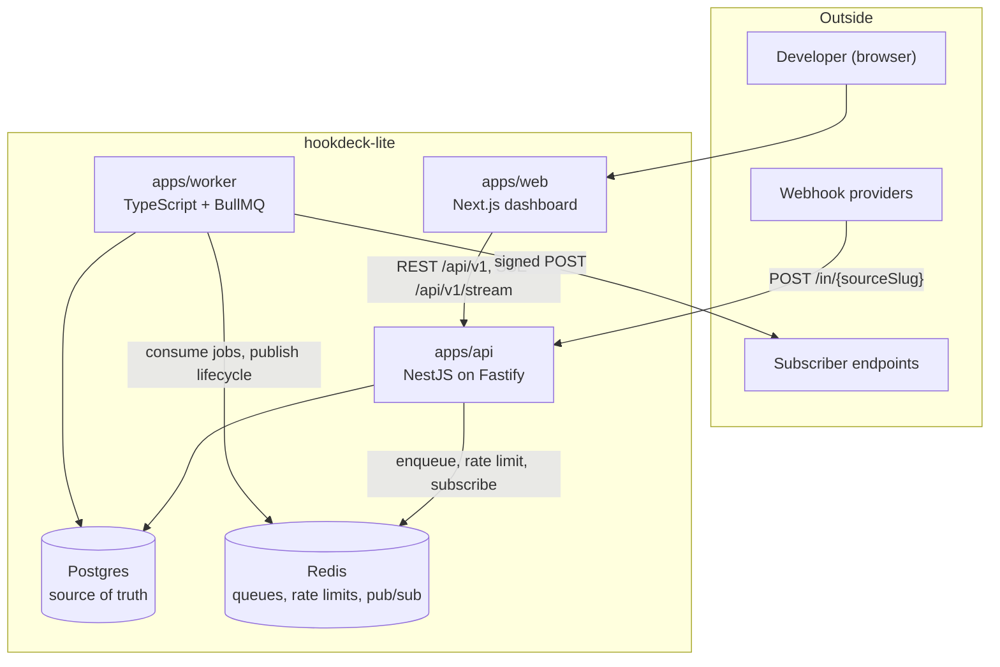
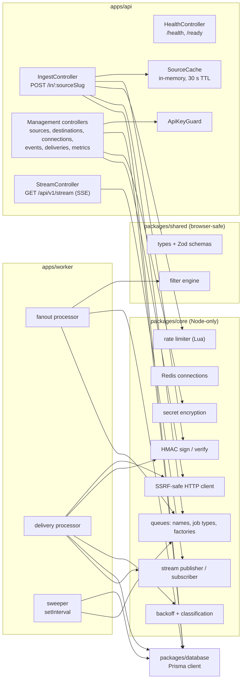
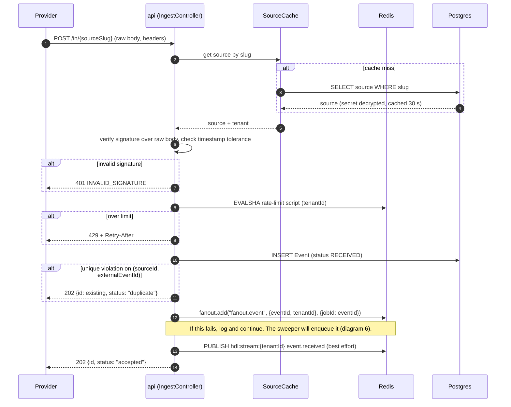
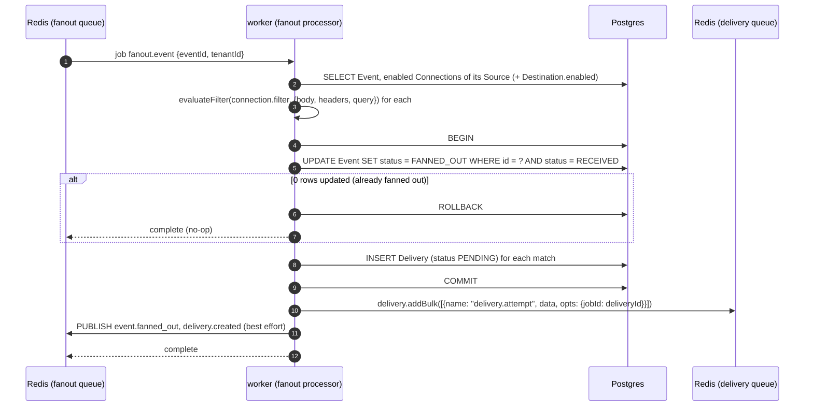
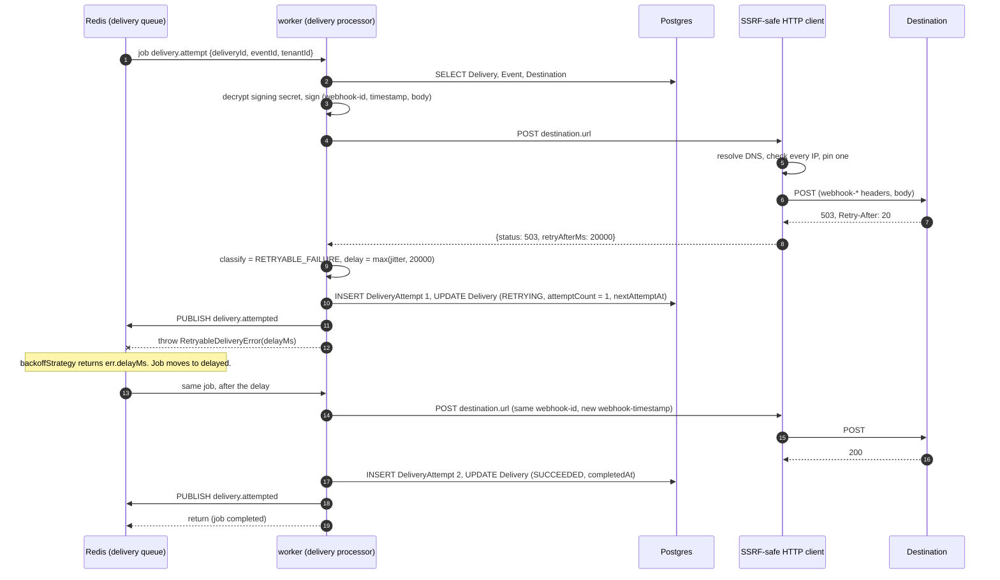
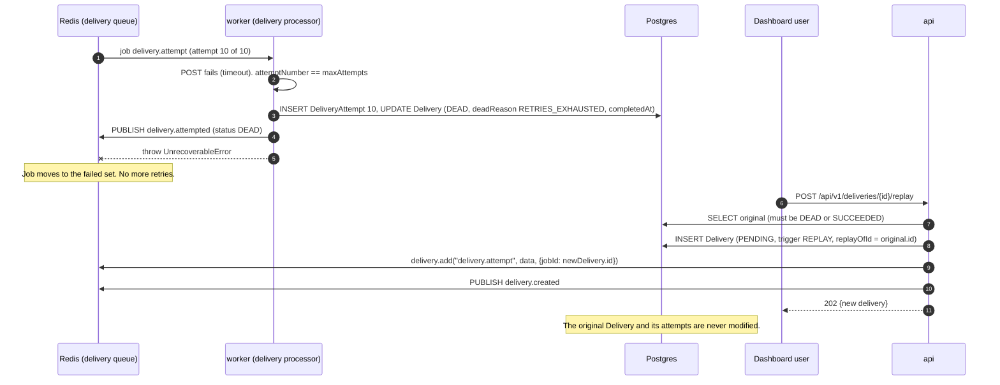
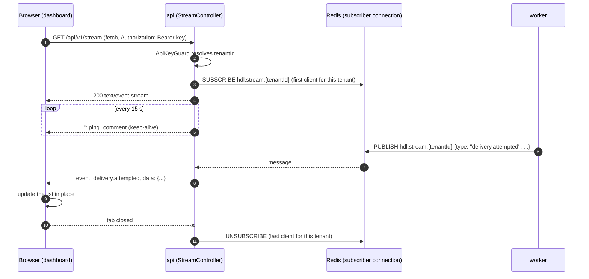
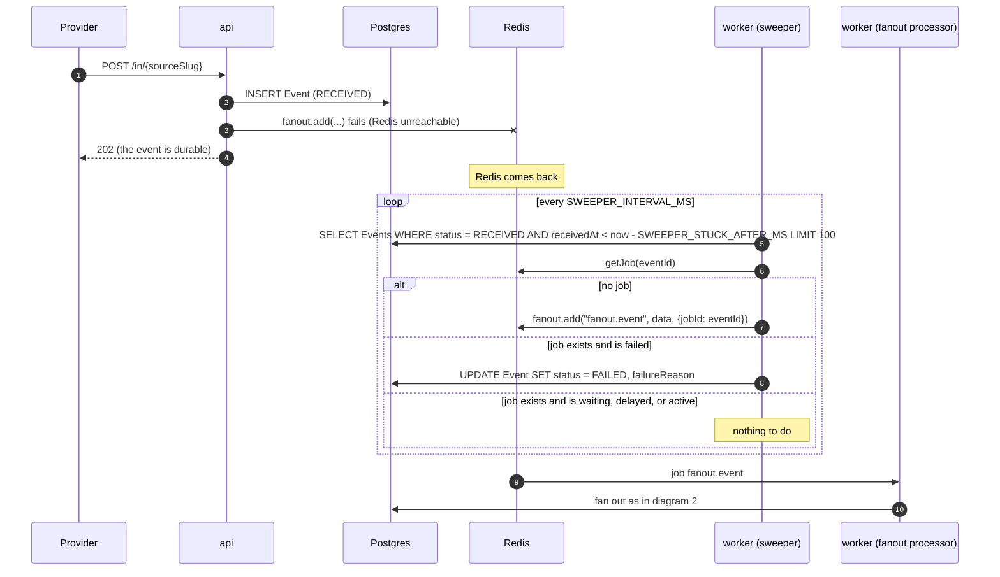

# Architecture

hookdeck-lite has three deployable apps and two data stores. The API accepts webhooks and serves the
dashboard's data. The worker does everything slow: fan-out, HTTP delivery, retries, and recovery.
Postgres holds every fact. Redis holds work in progress.

New to the domain? Read [learning/webhooks-101.md](learning/webhooks-101.md) and
[learning/bullmq-101.md](learning/bullmq-101.md) first.

## Containers

The API and the worker never call each other. They share Postgres, Redis, and the code in `packages/`.

## Components

| Package | May import | Must not import |
|---|---|---|
| `packages/shared` | `zod` only | anything Node-only, `core`, `database` |
| `packages/database` | Prisma, `pg` | `core` ¹, apps |
| `packages/core` | `shared`, `bullmq`, `ioredis`, `undici`, `ipaddr.js`, `pino` | `database`, apps |
| `apps/api` | `shared`, `database`, `core` | `apps/worker` |
| `apps/worker` | `shared`, `database`, `core` | `apps/api`, NestJS |
| `apps/web` | `shared` | `database`, `core` |

¹ The rule covers the library code in `packages/database/src`. The seed script (`prisma/seed.ts`) is an
entry point, not library code, and imports `core` to encrypt the secrets it stores:
[ADR-0018](adr/0018-seed-script-imports-core.md).

Why the split looks like this: [ADR-0002](adr/0002-service-split.md).

## Canonical names

Every doc, file, and test uses exactly these spellings.

### Entities and enums

| Name | Values |
|---|---|
| Entities | `Tenant`, `ApiKey`, `Source`, `Destination`, `Connection`, `Event`, `Delivery`, `DeliveryAttempt` |
| `EventStatus` | `RECEIVED`, `FANNED_OUT`, `FAILED` |
| `DeliveryStatus` | `PENDING`, `RETRYING`, `SUCCEEDED`, `DEAD` |
| `DeliveryTrigger` | `EVENT`, `REPLAY` |
| `AttemptOutcome` | `SUCCESS`, `RETRYABLE_FAILURE`, `PERMANENT_FAILURE` |
| Verification mode (string) | `standard-webhooks`, `generic-hmac`, `none` |
| Dead reason (string) | `RETRIES_EXHAUSTED`, `PERMANENT_FAILURE`, `STALLED` |
| Attempt error code (string) | `TIMEOUT`, `NETWORK_ERROR`, `DNS_ERROR`, `TLS_ERROR`, `SSRF_BLOCKED`, `REDIRECT_NOT_FOLLOWED`, `HTTP_ERROR` |
| Delivery-only error code (string) | `DESTINATION_DISABLED` (on `Delivery.lastErrorCode`, when a delivery is stopped without an attempt) |
| API error code (string) | `VALIDATION_ERROR`, `UNAUTHORIZED`, `NOT_FOUND`, `CONFLICT`, `INVALID_SIGNATURE`, `RATE_LIMITED`, `PAYLOAD_TOO_LARGE`, `UNSUPPORTED_MEDIA_TYPE`, `DESTINATION_URL_NOT_ALLOWED`, `SERVICE_UNAVAILABLE`, `INTERNAL` |

### Queues, jobs, Redis keys

| Thing | Name |
|---|---|
| BullMQ prefix | `hdl` (env `BULLMQ_PREFIX`) |
| Queues | `fanout`, `delivery` |
| Job names | `fanout.event`, `delivery.attempt` |
| Job id | `fanout` job id = `Event.id`; `delivery` job id = `Delivery.id` |
| Rate-limit keys | `hdl:rl:{tenantId}:{windowIndex}` |
| Pub/sub channel | `hdl:stream:{tenantId}` |
| Stream message types | `event.received`, `event.fanned_out`, `delivery.created`, `delivery.attempted` |

### HTTP

| Thing | Name |
|---|---|
| Ingestion | `POST /in/{sourceSlug}` |
| Management prefix | `/api/v1` |
| Stream | `GET /api/v1/stream` |
| Probes | `GET /health`, `GET /ready` |
| Auth header | `Authorization: Bearer <api key>` |
| API key format | `hdl_<8-char prefix>_<32-char secret>` |
| Outbound headers | `webhook-id`, `webhook-timestamp`, `webhook-signature`, `content-type`, `user-agent`, `x-hdl-delivery-id`, `x-hdl-attempt` |
| Outbound `user-agent` | `hookdeck-lite/1.0` |
| Request id header | `x-request-id` |
| Workspace packages | `@hdl/shared`, `@hdl/database`, `@hdl/core`, `@hdl/api`, `@hdl/worker`, `@hdl/web`, `@hdl/mock-receiver`, `@hdl/loadtest` |

### Configuration

| Env var | Used by | Default | Meaning |
|---|---|---|---|
| `NODE_ENV` | all | `development` | Standard |
| `LOG_LEVEL` | api, worker | `info` | pino level |
| `PORT` | api | `3001` | HTTP port. Render sets this |
| `DATABASE_URL` | api, worker, database | none | Postgres connection string |
| `REDIS_URL` | api, worker | none | Redis connection string |
| `BULLMQ_PREFIX` | api, worker | `hdl` | Key prefix for queues. Tests use a unique one |
| `CORS_ORIGINS` | api | `http://localhost:3000` | Comma-separated allowed origins for the dashboard |
| `SECRETS_MASTER_KEY` | api, worker | none | Base64 of 32 random bytes. Required |
| `SSRF_ALLOWLIST` | api, worker | empty | Comma-separated hostnames that bypass the IP-range check |
| `SIGNATURE_TOLERANCE_SECONDS` | api | `300` | Allowed clock difference for inbound timestamps |
| `INGEST_MAX_BODY_BYTES` | api | `1048576` | Largest accepted webhook body (1 MiB) |
| `DELIVERY_MAX_ATTEMPTS` | api, worker | `10` | Attempts per Delivery, first one included |
| `BACKOFF_BASE_MS` | worker | `30000` | Backoff base |
| `BACKOFF_CAP_MS` | worker | `3600000` | Largest single delay (1 h) |
| `DELIVERY_TIMEOUT_MS` | worker | `15000` | Total time allowed for one outbound request |
| `DELIVERY_MAX_RESPONSE_BYTES` | worker | `16384` | Response bytes read and stored (16 KiB) |
| `DELIVERY_CONCURRENCY` | worker | `50` | Concurrent delivery jobs per worker process |
| `FANOUT_CONCURRENCY` | worker | `10` | Concurrent fan-out jobs per worker process |
| `SWEEPER_INTERVAL_MS` | worker | `15000` | How often the sweeper runs |
| `SWEEPER_STUCK_AFTER_MS` | worker | `30000` | Age after which an item counts as stuck |
| `RETENTION_DAYS` | docs only until C2 | `30` | Intended retention |
| `SEED_API_KEY` | database seed | dev value in `.env.example` | API key the seed creates for the demo tenant |
| `NEXT_PUBLIC_API_URL` | web | `http://localhost:3001` | Base URL of the API |
| `MOCK_RECEIVER_PORT` | mock-receiver | `4000` | Port of the chaos endpoint |

`.env.example` for local development sets `SSRF_ALLOWLIST=localhost,127.0.0.1,mock-receiver`. Production sets it to empty.

## Sequence diagrams

### 1. Ingestion with fast ACK

The request does the minimum that makes the event durable, then returns. Why this order and why Postgres
first: [ADR-0004](adr/0004-ingestion-durability.md). Concept: [fast ACK](learning/webhooks-101.md#fast-ack).

Notes:

- Redis failures on steps 8, 13, and 14 never fail the request. Each Redis call from the API fails fast
  (no offline queue, one retry) so a Redis outage does not turn into slow responses.
- The only step that can turn a valid request into an error is Postgres: the source lookup on a cache
  miss, or the insert. Both answer `503`.
- The source cache has a 30 s TTL and holds the decrypted secret. Disabling a source, or changing its
  secret or its tenant's rate limit, takes up to 30 s to reach ingestion. Unknown slugs are not cached.
- Request logging is Fastify's built-in pino logger: one `incoming request` and one `request completed`
  line per request with method, url, status code and `requestId`. Headers and bodies are never logged.

### 2. Fan-out and filter evaluation

One Event becomes one Delivery per matching connection. The status flip and the inserts happen in one
transaction, so running the job twice is harmless. Filter semantics: [FILTER-RULES.md](FILTER-RULES.md).

Notes:

- The compare-and-set `UPDATE ... WHERE status = RECEIVED` is the idempotency guard.
- If the worker dies between `COMMIT` and `addBulk`, the Deliveries exist as `PENDING` with no job.
  The sweeper enqueues them.

### 3. Delivery with retry and backoff, ending in success

One job run is one HTTP attempt. The processor computes the next delay itself, stores it, and hands it to
BullMQ through the error it throws. Details: [QUEUES.md](QUEUES.md#delivery-processor).

### 4. Retries exhausted, DEAD, and manual replay

BullMQ has no dead-letter queue. The Delivery row is the dead letter. Why: [ADR-0007](adr/0007-dead-letter-and-replay.md).

A permanent failure (for example `404` or `410`) follows the same path on the first attempt, with
`deadReason = PERMANENT_FAILURE`.

### 5. Live SSE stream from worker to browser

Concepts: [Redis pub/sub](learning/bullmq-101.md#redis-pubsub), [Server-Sent Events](learning/reliability-patterns.md#server-sent-events).
Why SSE and why app-level pub/sub: [ADR-0011](adr/0011-live-stream.md).

Notes:

- The browser uses `fetch` with a streaming reader, not `EventSource`, because `EventSource` cannot send an
  `Authorization` header.
- Pub/sub does not store messages. A client that reconnects refetches its lists over REST. No `Last-Event-ID` replay.
- The API keeps one dedicated Redis subscriber connection for all tenants and reference-counts subscriptions.

### 6. Sweeper recovering an event that was never enqueued

The sweeper runs the same three-way check for Deliveries that are `PENDING`, or `RETRYING` with
`nextAttemptAt` in the past, older than `SWEEPER_STUCK_AFTER_MS`. Full rules: [QUEUES.md](QUEUES.md#sweeper).

## Failure modes

| Failure | What happens | What the user sees | How the system recovers |
|---|---|---|---|
| **Redis down** | Ingestion still inserts Events and returns `202`; the rate limiter fails open; enqueue fails and is logged. The worker cannot fetch jobs. The stream delivers nothing. | Events appear in the list as `RECEIVED` and stay there. `/ready` returns `503`. The live view goes quiet. | When Redis returns, BullMQ reconnects. The sweeper enqueues every stuck Event and Delivery within `SWEEPER_INTERVAL_MS + SWEEPER_STUCK_AFTER_MS`. If Redis lost its data, the sweeper rebuilds the jobs from Postgres. |
| **Postgres down** | Ingestion returns `503`; the provider retries later. Worker jobs throw and are retried by BullMQ with backoff. | Providers see `503`. The dashboard shows an error state. `/ready` returns `503`. | Automatic once Postgres is back. No event was acknowledged without being stored. |
| **Worker crash mid-job** | The job's lock expires. Another worker (or the restarted one) sees it as stalled after about 30 s and runs it again. | A delivery may be sent twice. The attempts timeline shows the attempts that were recorded. | [Stalled-job](learning/bullmq-101.md#stalled-jobs) recovery. Duplicates carry the same `webhook-id`, so receivers can discard them. A job that stalls more than once is failed by BullMQ; the `failed` listener or the sweeper marks the Delivery `DEAD` with `deadReason = STALLED`. |
| **Destination slow** | Each attempt is cut off at `DELIVERY_TIMEOUT_MS` and classified `RETRYABLE_FAILURE` (`TIMEOUT`). Concurrency (`DELIVERY_CONCURRENCY`) bounds how many slow requests are open. | Deliveries to that destination sit in `RETRYING` with growing gaps. Other destinations may queue behind it if the worker is saturated. | Backoff spreads the retries. Stretch goal C1 (circuit breaker) would stop sending while the destination is failing. |
| **Destination returns 410** | Classified `PERMANENT_FAILURE`. The Delivery becomes `DEAD` after one attempt. (Should S6: the destination is disabled with `disabledReason = "GONE_410"`.) | The delivery shows `DEAD` with status `410`. | Manual: fix or re-enable the destination, then replay. |
| **Duplicate inbound webhook** | The unique index on `(sourceId, externalEventId)` rejects the second insert. The API returns `202` with `status: "duplicate"` and the first event's id. | One event in the list. | Nothing to recover. Without an external id there is no deduplication. |
| **Poison payload** (a body or stored config that makes a processor throw every time) | The fan-out job fails 5 times with backoff, then BullMQ fails it; the Event becomes `FAILED` with `failureReason`. A delivery job that throws unexpectedly is retried up to `maxAttempts`, then `DEAD`. | The event shows `FAILED`, or the delivery shows `DEAD`, with the error. Other events are unaffected. | Manual. Fix the bug or config. There is no auto-retry of `FAILED` events. |
| **Clock skew on signatures** | Inbound: a timestamp outside ±`SIGNATURE_TOLERANCE_SECONDS` returns `401`. Outbound: receivers with a skewed clock may reject us. | Provider sees `401`s. Receiver-side rejections appear as `4xx` → `DEAD`. | Operator fixes NTP, or raises the tolerance. `webhook-timestamp` is the send time of each attempt, so retries hours later still verify. |

## Where state lives

| State | Store | Why |
|---|---|---|
| Tenants, API keys, sources, destinations, connections | Postgres | Configuration must survive everything |
| Events (headers, query, raw body) | Postgres | The durability promise of `202` |
| Deliveries and attempts | Postgres | History, DEAD list, replay, metrics |
| Jobs waiting, delayed, active | Redis (BullMQ) | Fast scheduling and locking. Rebuildable from Postgres by the sweeper |
| Rate-limit counters | Redis | Short-lived, needs atomic increments |
| Stream messages | Redis pub/sub | Ephemeral by design |
| Source lookup cache | API process memory | Avoids a query per webhook. 30 s TTL |

The rule: **if losing it would lose a customer's event or its history, it is in Postgres.** Redis can be
wiped and the system converges again, at the cost of possible duplicate deliveries. Job payloads carry ids
only, never bodies or secrets.

## Observability

- **Logs.** pino JSON to stdout in both apps. Each pipeline log has `tenantId`, `eventId`, and `deliveryId`
  where they apply, plus `requestId` in the API. Child loggers bind these once per request or job.
- **Probes.** `GET /health` is liveness: it returns `200 {"status":"ok"}` without touching dependencies.
  `GET /ready` runs `SELECT 1` and `PING` with a 1 s timeout each and returns `200` or `503` with per-check results.
- **Redaction.** `authorization`, `cookie`, `webhook-signature`, and any configured signature header are
  redacted from logs and from stored request headers.

Decision record: [ADR-0015](adr/0015-observability.md).
