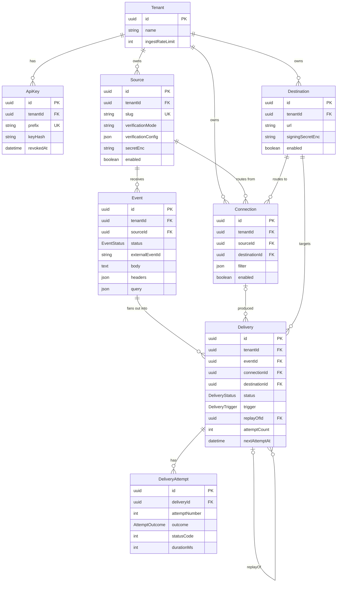
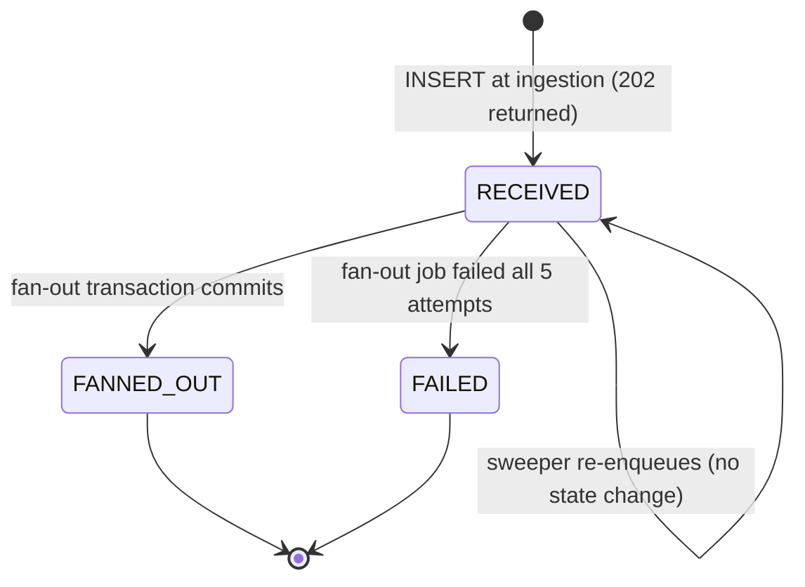
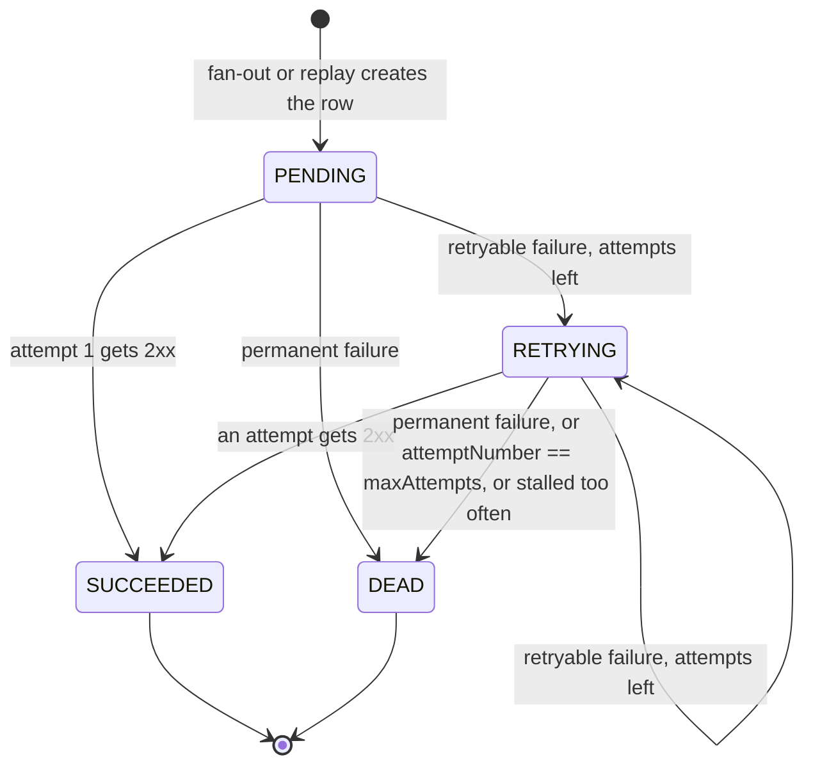

# Data model

Postgres is the source of truth. This document is the draft the Day 1 session turns into
`packages/database/prisma/schema.prisma`. Names here are canonical
([ARCHITECTURE.md](ARCHITECTURE.md#canonical-names)). Rationale: [ADR-0003](adr/0003-domain-model.md).

## Entities



In words: a **Tenant** owns **Sources** (inbound endpoints) and **Destinations** (outbound URLs). A
**Connection** links one Source to one Destination and may carry a filter. An incoming **Event** belongs to
a Source. Fan-out creates one **Delivery** per matching Connection. Each HTTP try is a **DeliveryAttempt**.

## Conventions

- **Ids are UUID v7**, generated by Prisma (`@default(uuid(7))`), stored as Postgres `uuid`. UUID v7 starts
  with a timestamp, so ids sort by creation time. That gives index locality and lets `ORDER BY id DESC`
  serve as "newest first" for cursor pagination. UUIDs contain no `:` and are not all digits, so they are
  valid BullMQ job ids ([bullmq-101](learning/bullmq-101.md#job-ids)).
- **Every tenant-owned row carries `tenantId`**, including `Delivery` and `DeliveryAttempt`, so every
  query can be scoped without joins.
- **Table and column names are Prisma defaults** (`"Delivery"."attemptCount"`). Raw SQL quotes identifiers.
- **Timestamps** are `timestamptz(3)`.
- **Deleting** a Source cascades to its Connections and Events. Deleting a Destination cascades to its
  Connections and Deliveries. Deleting a Connection keeps its Deliveries (`connectionId` becomes `NULL`).
  The dashboard warns before a delete that removes history.

## Prisma schema (draft)

Verified against Prisma ORM 7.10 docs on 2026-11-12: the `prisma-client` generator needs an explicit
`output`; the connection URL lives in `prisma.config.ts`, not in the `datasource` block; `uuid(7)`,
`@db.Uuid`, `Json`, enums, and sorted composite indexes are supported. Enum values in generated TypeScript
use the schema names.

```prisma
generator client {
  provider = "prisma-client"
  output   = "../src/generated/prisma"
}

datasource db {
  provider = "postgresql"
}

enum EventStatus {
  RECEIVED    // stored; fan-out not yet done
  FANNED_OUT  // deliveries created (possibly zero)
  FAILED      // fan-out failed permanently
}

enum DeliveryStatus {
  PENDING    // created; no attempt recorded yet
  RETRYING   // at least one failed attempt; another is scheduled
  SUCCEEDED  // a 2xx was received
  DEAD       // retries exhausted or permanent failure
}

enum DeliveryTrigger {
  EVENT   // created by fan-out
  REPLAY  // created by a replay request
}

enum AttemptOutcome {
  SUCCESS
  RETRYABLE_FAILURE
  PERMANENT_FAILURE
}

model Tenant {
  id              String   @id @default(uuid(7)) @db.Uuid
  name            String
  /// Ingestion requests allowed per 60-second sliding window.
  ingestRateLimit Int      @default(600)
  createdAt       DateTime @default(now()) @db.Timestamptz(3)
  updatedAt       DateTime @updatedAt @db.Timestamptz(3)

  apiKeys      ApiKey[]
  sources      Source[]
  destinations Destination[]
  connections  Connection[]
  events       Event[]
  deliveries   Delivery[]
}

model ApiKey {
  id         String    @id @default(uuid(7)) @db.Uuid
  tenantId   String    @db.Uuid
  name       String
  /// First 8 characters after "hdl_". Not secret. Used to find the row.
  prefix     String    @unique
  /// SHA-256 hex of the full key.
  keyHash    String
  lastUsedAt DateTime? @db.Timestamptz(3)
  revokedAt  DateTime? @db.Timestamptz(3)
  createdAt  DateTime  @default(now()) @db.Timestamptz(3)

  tenant Tenant @relation(fields: [tenantId], references: [id], onDelete: Cascade)

  @@index([tenantId])
}

model Source {
  id                 String   @id @default(uuid(7)) @db.Uuid
  tenantId           String   @db.Uuid
  name               String
  /// Globally unique, URL-safe. Appears in POST /in/{sourceSlug}.
  slug               String   @unique
  enabled            Boolean  @default(true)
  /// "standard-webhooks" | "generic-hmac" | "none"
  verificationMode   String
  /// Mode-specific settings, validated by Zod. See SECURITY.md.
  verificationConfig Json     @default("{}")
  /// AES-256-GCM envelope. Null when verificationMode is "none".
  secretEnc          String?
  /// Header that carries the provider's event id, lowercased. Null disables dedupe.
  dedupeHeader       String?
  createdAt          DateTime @default(now()) @db.Timestamptz(3)
  updatedAt          DateTime @updatedAt @db.Timestamptz(3)

  tenant      Tenant       @relation(fields: [tenantId], references: [id], onDelete: Cascade)
  connections Connection[]
  events      Event[]

  @@index([tenantId, id(sort: Desc)])
}

model Destination {
  id               String   @id @default(uuid(7)) @db.Uuid
  tenantId         String   @db.Uuid
  name             String
  url              String
  enabled          Boolean  @default(true)
  /// Why it was disabled automatically, e.g. "GONE_410". Null when disabled by a user.
  disabledReason   String?
  /// AES-256-GCM envelope of the whsec_ signing secret.
  signingSecretEnc String
  createdAt        DateTime @default(now()) @db.Timestamptz(3)
  updatedAt        DateTime @updatedAt @db.Timestamptz(3)

  tenant      Tenant       @relation(fields: [tenantId], references: [id], onDelete: Cascade)
  connections Connection[]
  deliveries  Delivery[]

  @@index([tenantId, id(sort: Desc)])
}

model Connection {
  id            String   @id @default(uuid(7)) @db.Uuid
  tenantId      String   @db.Uuid
  name          String
  sourceId      String   @db.Uuid
  destinationId String   @db.Uuid
  enabled       Boolean  @default(true)
  /// Filter rule (FILTER-RULES.md). Null matches every event.
  filter        Json?
  createdAt     DateTime @default(now()) @db.Timestamptz(3)
  updatedAt     DateTime @updatedAt @db.Timestamptz(3)

  tenant      Tenant      @relation(fields: [tenantId], references: [id], onDelete: Cascade)
  source      Source      @relation(fields: [sourceId], references: [id], onDelete: Cascade)
  destination Destination @relation(fields: [destinationId], references: [id], onDelete: Cascade)
  deliveries  Delivery[]

  @@unique([sourceId, destinationId])
  @@index([tenantId, id(sort: Desc)])
  @@index([destinationId])
}

model Event {
  id              String      @id @default(uuid(7)) @db.Uuid
  tenantId        String      @db.Uuid
  sourceId        String      @db.Uuid
  status          EventStatus @default(RECEIVED)
  /// Provider's id for this event (from Source.dedupeHeader). Null means "do not dedupe".
  externalEventId String?
  contentType     String
  /// Lowercased header names. Sensitive headers are redacted before storing.
  headers         Json
  query           Json
  /// The exact request body as UTF-8 text. Forwarded and signed byte-for-byte.
  body            String      @db.Text
  bodyBytes       Int
  deliveryCount   Int         @default(0)
  /// Connections whose filter did not match.
  filteredCount   Int         @default(0)
  failureReason   String?
  receivedAt      DateTime    @default(now()) @db.Timestamptz(3)
  fannedOutAt     DateTime?   @db.Timestamptz(3)

  tenant     Tenant     @relation(fields: [tenantId], references: [id], onDelete: Cascade)
  source     Source     @relation(fields: [sourceId], references: [id], onDelete: Cascade)
  deliveries Delivery[]

  /// Inbound dedupe. Postgres treats NULLs as distinct, so events without an external id never collide.
  @@unique([sourceId, externalEventId])
  @@index([tenantId, id(sort: Desc)])
  @@index([tenantId, sourceId, id(sort: Desc)])
  @@index([tenantId, status, id(sort: Desc)])
  /// Sweeper: WHERE status = 'RECEIVED' AND receivedAt < $1
  @@index([status, receivedAt])
  /// Metrics: events received in a window.
  @@index([tenantId, receivedAt])
}

model Delivery {
  id             String          @id @default(uuid(7)) @db.Uuid
  tenantId       String          @db.Uuid
  eventId        String          @db.Uuid
  connectionId   String?         @db.Uuid
  destinationId  String          @db.Uuid
  status         DeliveryStatus  @default(PENDING)
  trigger        DeliveryTrigger @default(EVENT)
  /// The delivery this one replays. Null for trigger EVENT.
  replayOfId     String?         @db.Uuid
  attemptCount   Int             @default(0)
  /// Copied from DELIVERY_MAX_ATTEMPTS when the row is created.
  maxAttempts    Int
  nextAttemptAt  DateTime?       @db.Timestamptz(3)
  lastAttemptAt  DateTime?       @db.Timestamptz(3)
  lastStatusCode Int?
  /// The last attempt's errorCode, or "DESTINATION_DISABLED" when stopped without an attempt.
  lastErrorCode  String?
  /// "RETRIES_EXHAUSTED" | "PERMANENT_FAILURE" | "STALLED". Set only when status is DEAD.
  deadReason     String?
  /// When the delivery reached SUCCEEDED or DEAD.
  completedAt    DateTime?       @db.Timestamptz(3)
  createdAt      DateTime        @default(now()) @db.Timestamptz(3)
  updatedAt      DateTime        @updatedAt @db.Timestamptz(3)

  tenant      Tenant            @relation(fields: [tenantId], references: [id], onDelete: Cascade)
  event       Event             @relation(fields: [eventId], references: [id], onDelete: Cascade)
  connection  Connection?       @relation(fields: [connectionId], references: [id], onDelete: SetNull)
  destination Destination       @relation(fields: [destinationId], references: [id], onDelete: Cascade)
  replayOf    Delivery?         @relation("DeliveryReplay", fields: [replayOfId], references: [id], onDelete: SetNull)
  replays     Delivery[]        @relation("DeliveryReplay")
  attempts    DeliveryAttempt[]

  @@index([tenantId, id(sort: Desc)])
  @@index([tenantId, status, id(sort: Desc)])
  /// DEAD view per destination and bulk replay.
  @@index([destinationId, status])
  @@index([eventId])
  @@index([replayOfId])
  /// Sweeper: PENDING by createdAt, RETRYING by nextAttemptAt.
  @@index([status, nextAttemptAt])
  @@index([status, createdAt])
  /// Metrics window scans.
  @@index([tenantId, completedAt])
}

model DeliveryAttempt {
  id                    String         @id @default(uuid(7)) @db.Uuid
  tenantId              String         @db.Uuid
  deliveryId            String         @db.Uuid
  /// 1-based.
  attemptNumber         Int
  outcome               AttemptOutcome
  statusCode            Int?
  /// "TIMEOUT" | "NETWORK_ERROR" | "DNS_ERROR" | "TLS_ERROR" | "SSRF_BLOCKED" | "REDIRECT_NOT_FOLLOWED" | "HTTP_ERROR"
  errorCode             String?
  errorMessage          String?
  startedAt             DateTime       @db.Timestamptz(3)
  /// Wall time of the HTTP request, connect to last byte read.
  durationMs            Int
  /// Parsed Retry-After, if the response had one.
  retryAfterMs          Int?
  /// The IP the request was pinned to.
  resolvedIp            String?
  /// Headers we sent. The signature value is redacted.
  requestHeaders        Json
  responseHeaders       Json?
  /// At most DELIVERY_MAX_RESPONSE_BYTES.
  responseBody          String?        @db.Text
  responseBodyTruncated Boolean        @default(false)
  createdAt             DateTime       @default(now()) @db.Timestamptz(3)

  delivery Delivery @relation(fields: [deliveryId], references: [id], onDelete: Cascade)

  /// Guards against recording the same attempt twice after a stalled job re-runs.
  @@unique([deliveryId, attemptNumber])
  @@index([tenantId, startedAt])
}
```

Notes for the implementer:

- `prisma.config.ts` sits next to the schema's package root and holds `datasource.url` and
  `migrations.seed`. Prisma 7 does not load `.env` by itself; the config file imports `dotenv/config`.
  Prisma 7.10 may name the generated config `prisma7.config.ts`; either name is fine.
- `migrate dev` no longer runs `generate` or the seed. Scripts call them explicitly.
- The client needs a driver adapter: `new PrismaClient({ adapter: new PrismaPg({ connectionString }) })`.
- The request body of an attempt is not stored per attempt. It is always `Event.body`.
- Events are immutable after insert except for `status`, `deliveryCount`, `filteredCount`,
  `failureReason`, and `fannedOutAt`.

## State machines

### Event status



| Transition | Who | Guard |
|---|---|---|
| → `RECEIVED` | api | Signature valid, under rate limit, not a duplicate |
| `RECEIVED` → `FANNED_OUT` | worker, fanout processor | `UPDATE ... WHERE status = 'RECEIVED'` affected 1 row |
| `RECEIVED` → `FAILED` | worker, fanout `failed` listener or sweeper | BullMQ job is in the failed set |

`FANNED_OUT` says nothing about delivery success. That lives on each Delivery.

### Delivery status



| Transition | Who | Guard |
|---|---|---|
| → `PENDING` | worker (fan-out) or api (replay) | none |
| → `RETRYING` | delivery processor | outcome `RETRYABLE_FAILURE` and `attemptNumber < maxAttempts` |
| → `SUCCEEDED` | delivery processor | outcome `SUCCESS` |
| → `DEAD` | delivery processor; `failed` listener; sweeper | outcome `PERMANENT_FAILURE`, or last attempt failed, or job failed in BullMQ without a recorded terminal state |

Rules:

- `SUCCEEDED` and `DEAD` are terminal. No code path updates a terminal Delivery. Every status update
  includes `WHERE status IN ('PENDING','RETRYING')`.
- A replay is a **new** row. The original keeps its status and attempts.
- The attempt insert and the Delivery update happen in one transaction.

## Retention

- Intended retention is `RETENTION_DAYS` (30). Deleting an Event cascades to its Deliveries and attempts.
- The retention job is stretch goal C2. Until it exists, operators run:

  ```sql
  DELETE FROM "Event" WHERE "receivedAt" < now() - interval '30 days';
  ```

- Bodies dominate storage. With 1 KiB average bodies and 16 KiB response captures, 100 000 events with
  two attempts each is roughly 3–4 GB at the worst case and far less in practice, because most responses are short.
- Redis retention is set per queue in [QUEUES.md](QUEUES.md#job-options).

## Dashboard metrics queries

All take `$1 = tenantId` and a window (`$2 = from`, `$3 = to`). They run through Prisma `$queryRaw` with a
tagged template, so parameters are bound, never concatenated.

### Summary: totals and success rate

Success rate is over deliveries that finished in the window: `SUCCEEDED / (SUCCEEDED + DEAD)`.

```sql
SELECT
  count(*) FILTER (WHERE "status" = 'SUCCEEDED')                         AS "succeeded",
  count(*) FILTER (WHERE "status" = 'DEAD')                              AS "dead",
  round(
    count(*) FILTER (WHERE "status" = 'SUCCEEDED')::numeric
    / nullif(count(*), 0), 4
  )                                                                      AS "successRate"
FROM "Delivery"
WHERE "tenantId" = $1
  AND "completedAt" >= $2 AND "completedAt" < $3;
```

Open work is a point-in-time count, not windowed:

```sql
SELECT "status", count(*) AS "count"
FROM "Delivery"
WHERE "tenantId" = $1 AND "status" IN ('PENDING', 'RETRYING')
GROUP BY "status";
```

Events received in the window:

```sql
SELECT count(*) AS "eventsReceived"
FROM "Event"
WHERE "tenantId" = $1 AND "receivedAt" >= $2 AND "receivedAt" < $3;
```

### Attempt latency percentiles

`percentile_cont` is an ordered-set aggregate: it sorts the group and interpolates the value at the given
fraction. Latency here is the HTTP round-trip of successful attempts.

```sql
SELECT
  percentile_cont(0.5)  WITHIN GROUP (ORDER BY "durationMs") AS "p50Ms",
  percentile_cont(0.95) WITHIN GROUP (ORDER BY "durationMs") AS "p95Ms",
  count(*)                                                   AS "attempts"
FROM "DeliveryAttempt"
WHERE "tenantId" = $1
  AND "startedAt" >= $2 AND "startedAt" < $3
  AND "outcome" = 'SUCCESS';
```

### End-to-end latency percentiles

Time from receipt to successful delivery, which includes queueing and retries.

```sql
SELECT
  percentile_cont(0.5)  WITHIN GROUP (ORDER BY extract(epoch FROM d."completedAt" - e."receivedAt") * 1000) AS "p50Ms",
  percentile_cont(0.95) WITHIN GROUP (ORDER BY extract(epoch FROM d."completedAt" - e."receivedAt") * 1000) AS "p95Ms"
FROM "Delivery" d
JOIN "Event" e ON e."id" = d."eventId"
WHERE d."tenantId" = $1
  AND d."status" = 'SUCCEEDED'
  AND d."trigger" = 'EVENT'
  AND d."completedAt" >= $2 AND d."completedAt" < $3;
```

### Time series for the charts

`$4` is the bucket width as an interval (`'1 minute'`, `'1 hour'`). `date_bin` needs Postgres 14 or later.

```sql
SELECT
  date_bin($4::interval, "completedAt", $2)                      AS "bucket",
  count(*) FILTER (WHERE "status" = 'SUCCEEDED')                 AS "succeeded",
  count(*) FILTER (WHERE "status" = 'DEAD')                      AS "dead"
FROM "Delivery"
WHERE "tenantId" = $1
  AND "completedAt" >= $2 AND "completedAt" < $3
GROUP BY 1
ORDER BY 1;
```

### Supporting indexes

| Query | Index |
|---|---|
| Summary, time series | `Delivery(tenantId, completedAt)` |
| Events received | `Event(tenantId, receivedAt)` |
| Open work | `Delivery(tenantId, status, id)` |
| Attempt percentiles | `DeliveryAttempt(tenantId, startedAt)` |
| Events list | `Event(tenantId, id DESC)`, `Event(tenantId, sourceId, id DESC)`, `Event(tenantId, status, id DESC)` |
| DEAD view, bulk replay | `Delivery(destinationId, status)` |

## Cursor pagination

Lists are ordered by `id DESC`. The cursor is the base64url of the last row's id.

```sql
SELECT * FROM "Event"
WHERE "tenantId" = $1 AND ($2::uuid IS NULL OR "id" < $2)
ORDER BY "id" DESC
LIMIT $3 + 1;   -- one extra row tells us whether there is a next page
```

Offset pagination is not used: it gets slower with depth and shifts under inserts, which is constant here.
