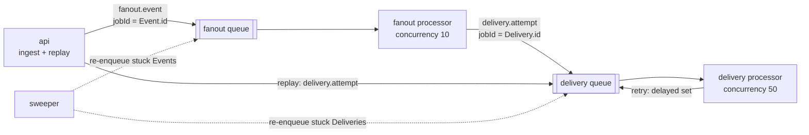

# Queues

How work moves through Redis. BullMQ concepts are explained in [learning/bullmq-101.md](learning/bullmq-101.md);
this document is the spec. Decisions: [ADR-0006](adr/0006-queues-backoff-classification.md),
[ADR-0007](adr/0007-dead-letter-and-replay.md).

Verified on 2026-11-12 against `bullmq@6.7.5` (type definitions and docs). BullMQ 6 no longer installs
`ioredis` for you: `packages/core` depends on both `bullmq` and `ioredis`.

## Topology



| Queue | Producers | Consumer | A job means |
|---|---|---|---|
| `fanout` | api (ingestion), sweeper | worker fanout processor | "Turn this Event into Deliveries" |
| `delivery` | fanout processor, api (replay), sweeper | worker delivery processor | "Make one HTTP attempt for this Delivery" (re-run for each retry) |

Two queues, not one, because the two kinds of work fail differently and need different concurrency and
retry policies. A slow destination must not delay fan-out of new events.

All queues use the BullMQ `prefix` from `BULLMQ_PREFIX` (default `hdl`). Do not use ioredis `keyPrefix`.

## Job payloads

Defined in `packages/core/src/queues/types.ts`. Payloads carry ids only. Bodies and secrets stay in
Postgres, which keeps Redis small and keeps sensitive data out of it.

```ts
export const QUEUE_FANOUT = 'fanout' as const;
export const QUEUE_DELIVERY = 'delivery' as const;

export const JOB_FANOUT_EVENT = 'fanout.event' as const;
export const JOB_DELIVERY_ATTEMPT = 'delivery.attempt' as const;

/** One per Event. jobId = eventId. */
export interface FanoutJobData {
  eventId: string;
  tenantId: string;
}

/** One per Delivery, re-run for each retry. jobId = deliveryId. */
export interface DeliveryJobData {
  deliveryId: string;
  eventId: string;
  tenantId: string;
}

/** Thrown by the delivery processor when another attempt should be made. */
export class RetryableDeliveryError extends Error {
  constructor(
    message: string,
    /** The delay the processor already computed and stored as Delivery.nextAttemptAt. */
    public readonly delayMs: number,
  ) {
    super(message);
    this.name = 'RetryableDeliveryError';
  }
}
```

The message published to the live stream (`packages/shared`, because the dashboard parses it):

```ts
export type StreamMessage =
  | { type: 'event.received';   at: string; data: { eventId: string; sourceId: string } }
  | { type: 'event.fanned_out'; at: string; data: { eventId: string; deliveryCount: number; filteredCount: number } }
  | { type: 'delivery.created'; at: string; data: { deliveryId: string; eventId: string; destinationId: string;
                                                    trigger: 'EVENT' | 'REPLAY'; replayOfId: string | null } }
  | { type: 'delivery.attempted'; at: string; data: { deliveryId: string; eventId: string; destinationId: string;
                                                      attemptNumber: number;
                                                      outcome: 'SUCCESS' | 'RETRYABLE_FAILURE' | 'PERMANENT_FAILURE';
                                                      statusCode: number | null; errorCode: string | null;
                                                      durationMs: number;
                                                      status: 'RETRYING' | 'SUCCEEDED' | 'DEAD';
                                                      nextAttemptAt: string | null } };
```

## Job IDs

| Queue | `jobId` | Effect |
|---|---|---|
| `fanout` | `Event.id` | The API and the sweeper can both add the job; the second add is ignored while the first job exists |
| `delivery` | `Delivery.id` | Same for the fan-out processor, replay, and the sweeper |

BullMQ ignores an `add` whose `jobId` already exists in the queue, in any state, until that job is removed.
Custom ids must not contain `:` and must not be all digits. UUIDs satisfy both.
Concept: [job IDs](learning/bullmq-101.md#job-ids).

The job id deduplicates **enqueues**. It does not make processing idempotent. Processors guard themselves:
the fan-out processor with a compare-and-set on `Event.status`, the delivery processor by returning early
when the Delivery is already terminal.

## Job options

```ts
// fanout: a failure here is a bug or an outage, so use BullMQ's built-in backoff.
const fanoutJobOptions = {
  attempts: 5,
  backoff: { type: 'exponential', delay: 1000, jitter: 0.5 },  // 1 s, 2 s, 4 s, 8 s, each jittered
  removeOnComplete: true,
  removeOnFail: { age: 24 * 3600, count: 1000 },
};

// delivery: the custom strategy reads the delay from the error the processor throws.
const deliveryJobOptions = {
  attempts: DELIVERY_MAX_ATTEMPTS,          // 10
  backoff: { type: 'custom' },
  removeOnComplete: { age: 3600, count: 1000 },
  removeOnFail: { age: 24 * 3600, count: 5000 },
};
```

- `age` is in seconds. Removal is lazy: it happens when another job finishes.
- Failed jobs are kept for a day so the sweeper can see them and for debugging. Postgres has the real history.

## Worker settings

| Setting | `fanout` | `delivery` | Notes |
|---|---|---|---|
| `concurrency` | `FANOUT_CONCURRENCY` (10) | `DELIVERY_CONCURRENCY` (50) | Delivery is I/O bound; 50 open requests is fine for one process |
| `lockDuration` | 30 000 (default) | 30 000 (default) | Longer than `DELIVERY_TIMEOUT_MS`, and renewed automatically anyway |
| `stalledInterval` | 30 000 (default) | 30 000 (default) | How often stalled jobs are looked for |
| `maxStalledCount` | 1 (default) | 1 (default) | A job that stalls twice is failed |
| `settings.backoffStrategy` | not set | set (below) | Lives on the Worker, not the Queue |

Why concurrency helps here and when it would not: [concurrency](learning/bullmq-101.md#concurrency).

## Redis connections

| Connection | Options | Why |
|---|---|---|
| API producer (Queue instances, rate limiter, publisher) | `maxRetriesPerRequest: 1`, `enableOfflineQueue: false` | Fail fast. Ingestion must not hang when Redis is down |
| API subscriber (stream) | dedicated connection | A connection in subscriber mode cannot run other commands |
| Worker (Worker instances) | `maxRetriesPerRequest: null` | Required by BullMQ for workers: blocking commands must retry forever |
| Worker producer (Queues used by fan-out and sweeper, publisher) | defaults | May wait for Redis; nothing user-facing blocks on it |

Redis itself must run with `maxmemory-policy noeviction`. With any other policy Redis may delete queue keys
under memory pressure and jobs vanish. Pitfalls: [bullmq-101](learning/bullmq-101.md#pitfalls).

## Fan-out processor

```
1. Load the Event. If missing or status != RECEIVED: return (already handled).
2. Load enabled Connections of event.sourceId whose Destination is enabled.
3. Parse event.body as JSON once. For each connection:
     match = connection.filter == null || evaluateFilter(connection.filter, { body, headers, query })
4. In one transaction:
     UPDATE Event SET status = FANNED_OUT, deliveryCount, filteredCount, fannedOutAt
       WHERE id = ? AND status = RECEIVED          -- 0 rows: return, someone else did it
     INSERT one Delivery (PENDING, trigger EVENT, maxAttempts) per match
5. delivery.addBulk(...) with jobId = each Delivery.id.
6. Publish event.fanned_out and one delivery.created per Delivery (best effort).
```

If step 5 fails, the processor throws; BullMQ retries the job; step 1 then returns early because the Event
is `FANNED_OUT`. The Deliveries are `PENDING` without jobs, and the sweeper enqueues them. That is why the
sweeper covers Deliveries too.

## Delivery processor

```
1. Load the Delivery with its Event and Destination.
   If Delivery is SUCCEEDED or DEAD: return.
   If Destination is disabled: mark DEAD (deadReason PERMANENT_FAILURE,
   lastErrorCode DESTINATION_DISABLED), no attempt row, throw UnrecoverableError.
2. attemptNumber = delivery.attemptCount + 1          -- Postgres is the counter of record
3. Build the request: decrypt signing secret, sign, set headers (SECURITY.md#outbound-signing).
4. Send with the SSRF-safe client (timeout, no redirects, capped response read).
5. Classify the result (table below).
6. In one transaction, guarded by WHERE status IN (PENDING, RETRYING):
     INSERT DeliveryAttempt(attemptNumber, outcome, ...)
     UPDATE Delivery:
       SUCCESS                                   -> SUCCEEDED, completedAt
       PERMANENT_FAILURE                         -> DEAD, deadReason PERMANENT_FAILURE, completedAt
       RETRYABLE_FAILURE, attemptNumber == max   -> DEAD, deadReason RETRIES_EXHAUSTED, completedAt
       RETRYABLE_FAILURE, attempts left          -> RETRYING, nextAttemptAt = now + delayMs
7. Publish delivery.attempted (best effort).
8. Tell BullMQ:
       SUCCEEDED -> return
       DEAD      -> throw new UnrecoverableError(reason)
       RETRYING  -> throw new RetryableDeliveryError(reason, delayMs)
```

Points that matter:

- **The attempt number comes from Postgres**, not from `job.attemptsMade`. After a stall or a Redis wipe
  the two can differ, and Postgres is the source of truth. If `attemptNumber` reaches `maxAttempts`, the
  processor throws `UnrecoverableError` regardless of what BullMQ thinks is left.
- **The unique index `(deliveryId, attemptNumber)`** turns a double record into an error instead of a
  duplicate row. On that error the processor reloads the Delivery and continues from its current state.
- **`UnrecoverableError`** (imported from `bullmq`) moves the job straight to the failed set and skips
  the remaining attempts.
- **A crash between step 4 and step 6** means the request was sent but not recorded. The job stalls and
  runs again, and the destination receives a duplicate with the same `webhook-id`. This is the
  at-least-once guarantee doing its job: [delivery guarantees](learning/webhooks-101.md#delivery-guarantees).

### Backoff strategy wiring

```ts
// LEARN: backoffStrategy lives on the Worker. BullMQ calls it after the processor throws,
// passing the error. See docs/learning/bullmq-101.md#retries
const worker = new Worker<DeliveryJobData>(QUEUE_DELIVERY, processDelivery, {
  connection,
  prefix,
  concurrency: DELIVERY_CONCURRENCY,
  settings: {
    backoffStrategy: (attemptsMade, _type, err) =>
      err instanceof RetryableDeliveryError
        ? err.delayMs
        // An unexpected exception (bug, Postgres down): no stored delay, compute one.
        : computeBackoffDelay({ attemptNumber: attemptsMade, retryAfterMs: null }),
  },
});
```

The signature is `(attemptsMade: number, type?: string, err?: Error, job?: MinimalJob) => number | Promise<number>`.
Returning `-1` would fail the job without retrying; returning `0` retries immediately.

## Response classification

`classifyResponse` in `packages/core` is a pure function. This table is its specification and its test list.

| Result of the attempt | Outcome | `errorCode` | Honors `Retry-After` |
|---|---|---|---|
| `2xx` | `SUCCESS` | none | no |
| `3xx` | `PERMANENT_FAILURE` | `REDIRECT_NOT_FOLLOWED` | no |
| `408` | `RETRYABLE_FAILURE` | `HTTP_ERROR` | no |
| `429` | `RETRYABLE_FAILURE` | `HTTP_ERROR` | **yes** |
| Any other `4xx` (including `400`, `401`, `403`, `404`, `410`, `422`) | `PERMANENT_FAILURE` | `HTTP_ERROR` | no |
| `503` | `RETRYABLE_FAILURE` | `HTTP_ERROR` | **yes** |
| Any other `5xx` | `RETRYABLE_FAILURE` | `HTTP_ERROR` | no |
| `1xx` or a status outside 100–599 | `RETRYABLE_FAILURE` | `HTTP_ERROR` | no |
| Request exceeded `DELIVERY_TIMEOUT_MS` | `RETRYABLE_FAILURE` | `TIMEOUT` | no |
| Connection refused, reset, closed early | `RETRYABLE_FAILURE` | `NETWORK_ERROR` | no |
| DNS lookup failed (`ENOTFOUND`, `EAI_AGAIN`) | `RETRYABLE_FAILURE` | `DNS_ERROR` | no |
| TLS handshake or certificate error | `RETRYABLE_FAILURE` | `TLS_ERROR` | no |
| Resolved IP is in a blocked range, or scheme not http/https | `PERMANENT_FAILURE` | `SSRF_BLOCKED` | no |

Reasoning:

- **Retryable** means "the same request might succeed later": the server was overloaded, restarting, or unreachable.
- **Permanent** means "the receiver understood and refused": retrying an unauthorized or malformed request
  only adds load. A human must fix something, then replay.
- `3xx` is permanent because we do not follow redirects ([SECURITY.md](SECURITY.md#ssrf-protection)); the
  operator should update the URL.
- A response larger than `DELIVERY_MAX_RESPONSE_BYTES` is truncated, not failed. The status code decides.

## Backoff

Concept and the reason for jitter: [backoff and jitter](learning/reliability-patterns.md#backoff-and-jitter).

`computeBackoffDelay` in `packages/core` is a pure function that takes the random source as a parameter,
so tests are deterministic.

```
n            = number of the attempt that just failed (1-based)
ceiling(n)   = min(BACKOFF_CAP_MS, BACKOFF_BASE_MS * 2^(n - 1))
jittered     = floor(random() * ceiling(n))              # "full jitter": uniform in [0, ceiling)
retryAfter   = min(retryAfterMs ?? 0, BACKOFF_CAP_MS)    # only for 429 and 503
delayMs      = max(jittered, retryAfter)
```

- **Exponential**: each ceiling doubles, so a destination that stays down is contacted less and less often.
- **Full jitter**: the delay is random between zero and the ceiling, so deliveries that failed together do
  not retry together.
- **Cap**: no single wait exceeds `BACKOFF_CAP_MS`.
- **Retry-After**: the receiver's request is a floor on the delay, itself capped so a hostile or broken
  receiver cannot park a job for a year. `Retry-After` may be seconds (`120`) or an HTTP date; both are
  parsed, and a value in the past or unparsable is ignored.

### Worked delay table

Defaults: `BACKOFF_BASE_MS = 30000`, `BACKOFF_CAP_MS = 3600000`, `DELIVERY_MAX_ATTEMPTS = 10`.
"Expected" is the mean of the uniform distribution, half the ceiling.

| After failed attempt | Ceiling | Delay range | Expected delay | Cumulative wait, worst case | Cumulative wait, expected |
|---|---|---|---|---|---|
| 1 | 30 s | 0–30 s | 15 s | 30 s | 15 s |
| 2 | 1 min | 0–1 min | 30 s | 1 min 30 s | 45 s |
| 3 | 2 min | 0–2 min | 1 min | 3 min 30 s | 1 min 45 s |
| 4 | 4 min | 0–4 min | 2 min | 7 min 30 s | 3 min 45 s |
| 5 | 8 min | 0–8 min | 4 min | 15 min 30 s | 7 min 45 s |
| 6 | 16 min | 0–16 min | 8 min | 31 min 30 s | 15 min 45 s |
| 7 | 32 min | 0–32 min | 16 min | 1 h 3 min 30 s | 31 min 45 s |
| 8 | 1 h (64 min capped) | 0–1 h | 30 min | 2 h 3 min 30 s | 1 h 1 min 45 s |
| 9 | 1 h (capped) | 0–1 h | 30 min | 3 h 3 min 30 s | 1 h 31 min 45 s |
| 10 | none | Delivery becomes `DEAD` | | | |

So a delivery to a dead endpoint is attempted 10 times over at most 3 h 3 min 30 s of waiting, plus up to
10 × 15 s of request time: **at most 3 h 6 min** (NFR3). On average it takes about 1 h 32 min.

Example with `Retry-After`: attempt 2 fails with `429` and `Retry-After: 300`. The ceiling is 1 min, the
jittered value is, say, 41 s, and `retryAfter` is 300 s, so the delay is 300 s.

Profiles:

| Profile | `BACKOFF_BASE_MS` | `BACKOFF_CAP_MS` | `DELIVERY_MAX_ATTEMPTS` | Worst-case total wait |
|---|---|---|---|---|
| Default | 30000 | 3600000 | 10 | 3 h 3 min 30 s |
| Demo (`.env.demo`) | 1000 | 10000 | 5 | 15 s (1 + 2 + 4 + 8) |
| Integration tests | 20 | 200 | 4 | 140 ms (20 + 40 + 80) |

## Stalled jobs

A worker holds a lock on each active job and renews it every `lockDuration / 2`. If the process dies or
its event loop is blocked for too long, the lock expires. Any worker's stalled-check (every
`stalledInterval`) then moves the job back to waiting and it runs again. Concept:
[stalled jobs](learning/bullmq-101.md#stalled-jobs).

| Situation | Result |
|---|---|
| Job stalls once | Re-run. `attemptsMade` is not increased. A duplicate delivery is possible |
| Job stalls more than `maxStalledCount` (1) | BullMQ fails it with `job stalled more than allowable limit`, without running the processor |
| That failure for a `delivery` job | The worker's `failed` listener marks the Delivery `DEAD`, `deadReason = STALLED`, if it is not terminal. If the listener cannot write, the sweeper does it later |
| That failure for a `fanout` job | The `failed` listener marks the Event `FAILED` if it is still `RECEIVED`; otherwise the sweeper does |

The `failed` listener has the signature `(job: Job | undefined, error: Error, prev: string)` and fires on
**every** failed attempt, not only the last. It must act only when the job will not run again:
`error instanceof UnrecoverableError`, or `job.attemptsMade >= job.opts.attempts`, or the stalled-limit message.
`UNVERIFIED`: that `failed` fires per attempt is from BullMQ 5 behaviour and the v6 type signature; the
Day 2 session must confirm it with a test.

## Sweeper

A `setInterval` in the worker process, every `SWEEPER_INTERVAL_MS`. It is a reconciler: it compares what
Postgres says should be in progress with what Redis actually has. Why not a BullMQ Job Scheduler:
[ADR-0004](adr/0004-ingestion-durability.md).

Candidates, each query limited to 100 rows, oldest first:

| Kind | Query |
|---|---|
| Stuck Events | `status = RECEIVED AND receivedAt < now - SWEEPER_STUCK_AFTER_MS` |
| Stuck new Deliveries | `status = PENDING AND createdAt < now - SWEEPER_STUCK_AFTER_MS` |
| Stuck retries | `status = RETRYING AND nextAttemptAt < now - SWEEPER_STUCK_AFTER_MS` |

For each candidate, `queue.getJob(id)` then:

| Job state | Action |
|---|---|
| No job | `queue.add(name, data, { jobId: id, ...options })` |
| `waiting`, `delayed`, `active`, `prioritized` | Nothing. It is in progress |
| `failed` | Mark the row terminal: Event → `FAILED`; Delivery → `DEAD` with `deadReason = STALLED` (or `RETRIES_EXHAUSTED` if `attemptCount >= maxAttempts`) |
| `completed` | Log a warning. A completed job with a non-terminal row indicates a bug |

Properties:

- **Idempotent.** Running it twice, or in two worker processes at once, has the same effect as once.
- **Safe when Redis is down.** It logs and waits for the next tick.
- **Bounded.** At most 300 rows per tick.

Worst-case recovery time after Redis returns: `SWEEPER_STUCK_AFTER_MS + SWEEPER_INTERVAL_MS` = 45 s.

## Graceful shutdown

Concept: [graceful shutdown](learning/bullmq-101.md#graceful-shutdown).

```
on SIGTERM or SIGINT (once):
  1. log "shutting down"; stop the sweeper interval
  2. await Promise.race([
       Promise.all([fanoutWorker.close(), deliveryWorker.close()]),   // stop fetching, wait for active jobs
       timeout(25 000)
     ])
  3. if the timeout won: await both workers' close(true)               // force; jobs will be seen as stalled
  4. close Queue instances, Redis connections, Prisma
  5. process.exit(0)
```

- `worker.close()` stops taking new jobs and resolves when the active ones finish. It has no timeout of
  its own, hence the race.
- 25 s is under the platform's kill deadline (Render sends `SIGTERM`, then `SIGKILL` after 30 s by default).
  It is above `DELIVERY_TIMEOUT_MS` (15 s), so every in-flight attempt can finish and be recorded.
- **Windows:** `SIGTERM` is never delivered on Windows. `Ctrl+C` sends `SIGINT`, which is why both are
  handled. Containers run Linux and receive `SIGTERM`.
- **Docker:** use the exec form `CMD ["node", "dist/main.js"]` and `init: true` in compose so the signal
  reaches Node instead of a shell.
- The API does the same with NestJS `app.enableShutdownHooks()`: stop accepting connections, end SSE
  streams, close the subscriber, close Queue instances and Prisma.

## What happens to in-flight jobs on deploy

| Job state at deploy | What happens |
|---|---|
| Waiting or delayed | Stay in Redis. The new worker picks them up. No effect |
| Active, finishes within 25 s | Completes normally on the old worker, attempt recorded |
| Active, still running at 25 s | Old worker force-closes. The lock expires; the new worker re-runs the job after the next stalled check (up to about 30–60 s later). A duplicate delivery is possible |
| Process killed without `SIGTERM` (crash, OOM) | Same as the row above for every active job |

No job is lost in any row. The cost is latency and, in the last two rows, a possible duplicate.
During a deploy both the old and new worker run briefly; that is safe because BullMQ's locks ensure each
job is processed by one worker at a time.
