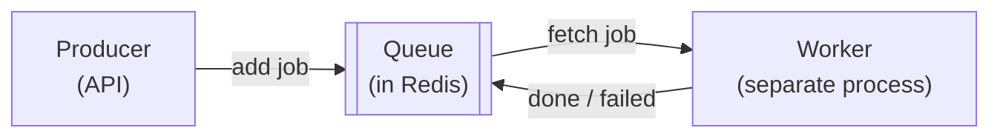
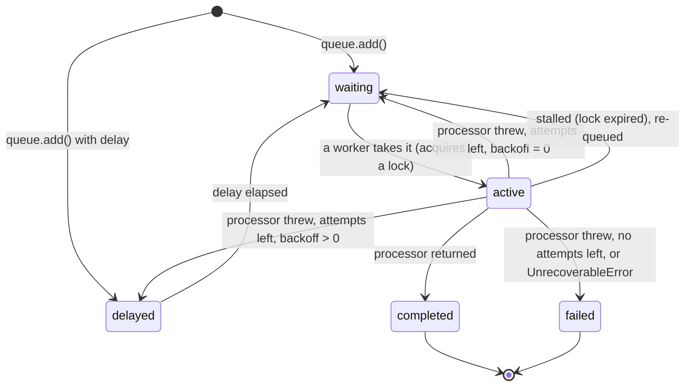
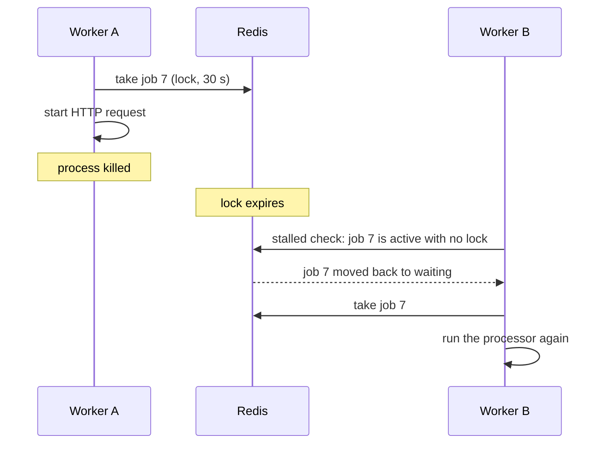

# BullMQ 101

For a TypeScript developer who has not used a job queue before. BullMQ is a queue library for Node.js
that stores everything in Redis. This document covers what this project uses, checked against
`bullmq@6.7.x` on 2026-11-12. Most tutorials online target v4 or v5; where v6 differs, it is noted.

## Why a queue at all

Some work should not happen inside an HTTP request: it is slow, it can fail and need retrying, or it must
survive a restart. A **job queue** lets one process say "this needs doing" and another process do it
later.



The queue gives you four things you would otherwise build by hand: persistence (jobs survive restarts),
retries with delays, concurrency control, and the guarantee that each job is handled by one worker at a time.

## Redis as a queue

Redis is an in-memory data store with a few data structures: strings, hashes, lists, sets, sorted sets,
streams. It runs commands one at a time on a single thread, which makes each command atomic.

BullMQ builds a queue out of these. Simplified, for a queue named `delivery` with prefix `hdl`:

| Redis key | Type | Holds |
|---|---|---|
| `hdl:delivery:<jobId>` | hash | One job: data, options, attempts made, timestamps |
| `hdl:delivery:wait` | list | Ids of jobs ready to run |
| `hdl:delivery:active` | list | Ids of jobs being processed |
| `hdl:delivery:delayed` | sorted set | Ids of jobs waiting for a time, scored by that time |
| `hdl:delivery:completed`, `:failed` | sorted sets | Ids of finished jobs |
| `hdl:delivery:events` | stream | A log of what happened, read by `QueueEvents` |

Moving a job from `wait` to `active` involves several keys. BullMQ does each such transition in a Lua
script so that it is atomic (see [Lua scripts](#lua-scripts)). You never touch these keys directly, but
knowing they exist explains a lot: why job ids cannot contain `:`, why large payloads hurt, why Redis
must not evict keys.

Redis keeps data in memory and writes it to disk in the background. It can lose the last moments of
writes in a crash. That is why this project treats Redis as rebuildable and Postgres as the truth
([ADR-0004](../adr/0004-ingestion-durability.md)).

## The four classes

```ts
import { Queue, Worker, QueueEvents, type Job } from 'bullmq';
import IORedis from 'ioredis';   // v6: you install ioredis yourself; it is a peer dependency
```

**`Queue`** is the producer's handle. It adds jobs and inspects the queue.

```ts
const deliveryQueue = new Queue<DeliveryJobData>('delivery', { connection, prefix: 'hdl' });

await deliveryQueue.add('delivery.attempt', { deliveryId, eventId, tenantId }, {
  jobId: deliveryId,
  attempts: 10,
  backoff: { type: 'custom' },
});
```

**`Worker`** is the consumer. You give it a function (the **processor**). It fetches jobs and calls it.

```ts
const worker = new Worker<DeliveryJobData>(
  'delivery',
  async (job: Job<DeliveryJobData>) => {
    // Return normally -> job completed. Throw -> job failed (and maybe retried).
  },
  { connection: workerConnection, prefix: 'hdl', concurrency: 50 },
);

worker.on('error', (err) => logger.error({ err }, 'worker error'));   // always attach this
```

**`Job`** is one unit of work: `job.id`, `job.name`, `job.data`, `job.opts`, `job.attemptsMade`.

**`QueueEvents`** lets any process listen to what happens in a queue, across all workers, by reading the
events stream.

```ts
const events = new QueueEvents('delivery', { connection });
events.on('completed', ({ jobId }) => { /* ... */ });
events.on('failed', ({ jobId, failedReason }) => { /* ... */ });
```

A worker also emits local events (`worker.on('completed' | 'failed' | 'stalled' | 'error')`), but only
for jobs that *this* worker instance handled. `QueueEvents` sees everything. hookdeck-lite uses worker
events as a backstop and does not use `QueueEvents`; the reasons are in
[ADR-0011](../adr/0011-live-stream.md).

Older tutorials also mention `QueueScheduler`. It has not been needed since BullMQ 2.

## Job lifecycle



- **waiting**: ready, in line.
- **active**: a worker holds a **lock** on it and is running the processor.
- **delayed**: parked until a timestamp. Retries with backoff live here.
- **completed** / **failed**: finished. Kept or removed according to `removeOnComplete` / `removeOnFail`.

By default finished jobs are kept **forever**, which slowly fills Redis. Always set retention:

```ts
removeOnComplete: { age: 3600, count: 1000 },   // age in seconds
removeOnFail: { age: 24 * 3600, count: 5000 },
```

The states of this project's two queues are specified in [QUEUES.md](../QUEUES.md).

## Retries

A job is retried when its processor throws and it has attempts left.

```ts
await queue.add('name', data, {
  attempts: 5,                                       // total tries, the first one included
  backoff: { type: 'exponential', delay: 1000 },     // wait 1 s, 2 s, 4 s, 8 s between tries
});
```

Built-in backoff types are `fixed` and `exponential` (`delay × 2^(attempt−1)`), and both accept
`jitter` between 0 and 1. For anything else you write a **custom backoff strategy**. In BullMQ it is a
setting on the **Worker**, not the Queue:

```ts
const worker = new Worker('delivery', processor, {
  connection,
  settings: {
    // (attemptsMade, type, err, job) => milliseconds to wait
    backoffStrategy: (attemptsMade, type, err, job) => {
      return attemptsMade * 1000;
    },
  },
});

// The job opts in by naming a non-built-in type:
await queue.add('name', data, { attempts: 10, backoff: { type: 'custom' } });
```

- `attemptsMade` is how many attempts have failed so far (1 after the first failure).
- `err` is the error the processor threw. This is the hook hookdeck-lite uses: the processor computes the
  delay (it knows about `Retry-After`), stores it in Postgres, and throws an error that carries it; the
  strategy just returns `err.delayMs`. See [QUEUES.md](../QUEUES.md#backoff-strategy-wiring).
- Return `0` to retry immediately, `-1` to give up and fail the job.

To stop retrying no matter how many attempts remain, throw `UnrecoverableError`:

```ts
import { UnrecoverableError } from 'bullmq';

if (response.status === 404) {
  throw new UnrecoverableError('destination returned 404');   // straight to failed
}
```

Why the delays should be random, not just growing: [backoff and jitter](reliability-patterns.md#backoff-and-jitter).

## Job IDs

By default BullMQ assigns increasing numbers. You can supply your own:

```ts
await queue.add('fanout.event', { eventId, tenantId }, { jobId: eventId });
```

The property that matters: **adding a job whose id already exists in the queue does nothing.** The call
succeeds and the existing job is untouched. That turns the id into a deduplication key.

```ts
await queue.add('fanout.event', data, { jobId: 'evt-1' });   // added
await queue.add('fanout.event', data, { jobId: 'evt-1' });   // ignored: evt-1 already exists
```

This is what makes hookdeck-lite's sweeper safe. It can call `add` for every event that looks stuck
without checking first; if a job is already there, nothing happens.

Rules and limits:

- An id must not contain `:` (BullMQ uses it as a key separator) and must not be all digits. UUIDs are fine.
- "Exists" includes completed and failed jobs that have not been removed yet. After removal the id can be reused.
- The id deduplicates the *enqueue*. It does not stop a job from running twice (see [stalled jobs](#stalled-jobs)).
  The processor must also be [idempotent](webhooks-101.md#idempotency).

BullMQ also has a separate `deduplication` option (`{ deduplication: { id, ttl } }`) for throttling and
debouncing. We do not use it; the job id is enough. (v6 removed the older `debounce` name.)

## Stalled jobs

When a worker takes a job it acquires a **lock** with an expiry (`lockDuration`, default 30 s) and renews
it periodically (every half `lockDuration`). The lock says "someone is working on this."

If the worker process dies, or its event loop is blocked so long that it cannot renew, the lock expires.
Workers periodically check for active jobs without a valid lock (`stalledInterval`, default 30 s). Such a
job is **stalled**: BullMQ moves it back to `waiting` and another worker runs it again.



What to take from this:

- **A job can run more than once.** Worker A may have sent the HTTP request before dying. Worker B sends
  it again. This is the main source of duplicate deliveries, and why the system is
  [at-least-once](webhooks-101.md#delivery-guarantees).
- A stall does not count as a failed attempt (`attemptsMade` is not increased).
- A job that stalls more than `maxStalledCount` times (default 1) is moved to `failed` with the reason
  `job stalled more than allowable limit`. The processor does not run for that, so any cleanup must
  happen in a `failed` listener. hookdeck-lite's handling is in [QUEUES.md](../QUEUES.md#stalled-jobs).
- **Do not block the event loop** in a processor. A long synchronous loop or a huge `JSON.parse` stops
  lock renewal and makes a healthy job look dead. CPU-heavy work belongs in a sandboxed processor (a
  separate process); we have none.

## Concurrency

`concurrency` is how many jobs one Worker instance processes at the same time. The default is 1.

```ts
new Worker('delivery', processor, { connection, concurrency: 50 });
```

Node runs JavaScript on one thread, so this is not parallel computation. It is 50 processors interleaved
on the event loop, which is exactly right when each one spends its time waiting on the network. For
hookdeck-lite's delivery jobs (one HTTP request each), high concurrency is cheap. For CPU-bound work it
would not help at all.

To scale further, or to stay available when one process dies, run more worker processes. They all pull
from the same queue, and locks ensure each job goes to one of them.

Concurrency is also a safety limit: with `concurrency: 50`, at most 50 outbound requests are open at once
per worker, however many jobs are waiting. See [backpressure](reliability-patterns.md#backpressure).

## Graceful shutdown

When a process is told to stop (a deploy, `Ctrl+C`), the polite sequence is: stop taking new jobs, let
the running ones finish, then exit.

```ts
async function shutdown(signal: string) {
  logger.info({ signal }, 'shutting down');
  await worker.close();        // stops fetching; resolves when active jobs have finished
  await connection.quit();
  process.exit(0);
}

process.on('SIGTERM', () => void shutdown('SIGTERM'));   // sent by Docker, Render, Kubernetes
process.on('SIGINT', () => void shutdown('SIGINT'));     // Ctrl+C
```

- `worker.close()` has no timeout of its own. If a job hangs, shutdown hangs, and the platform kills the
  process anyway (`SIGKILL`) after its grace period. So race it against your own deadline and then call
  `worker.close(true)` to force.
- Jobs that were still active when the process died are not lost. Their locks expire and they are
  re-run as [stalled jobs](#stalled-jobs), possibly producing a duplicate.
- On **Windows**, `SIGTERM` is never delivered to a Node process. `Ctrl+C` produces `SIGINT`. Handle both.
- In Docker, start Node directly (`CMD ["node", "dist/main.js"]`), not through a shell or `npm`, or the
  signal goes to the wrong process.

The project's exact sequence is in [QUEUES.md](../QUEUES.md#graceful-shutdown).

## Lua scripts

Redis can run a small Lua program on the server with `EVAL`. While a script runs, no other client's
command is executed. So a script is **atomic**: a read-decide-write sequence inside it cannot be
interleaved with anyone else's.

Why that matters, with a rate limiter as the example:

```ts
// Two Node processes run this at the same moment. Both read 9, both see "under 10", both increment.
const n = Number(await redis.get(key));       // 9        | 9
if (n < 10) await redis.incr(key);            // -> 10    | -> 11   (limit broken)
```

```lua
-- As a script, the read and the write are one step. The second caller sees 10 and is refused.
local n = tonumber(redis.call('GET', KEYS[1]) or '0')
if n >= tonumber(ARGV[1]) then return 0 end
redis.call('INCR', KEYS[1])
return 1
```

```ts
const allowed = await redis.eval(script, 1, key, 10);   // 1 key, then keys, then args
```

`MULTI`/`EXEC` transactions also group commands, but you cannot branch on a value you read inside one.
A script can. That is why "check a counter and increment it only if under the limit" needs Lua.

In practice you load the script once and call it by its hash (`EVALSHA`), which ioredis does for you with
`redis.defineCommand`. Keep scripts short: while one runs, Redis does nothing else.

BullMQ itself is mostly Lua scripts for this reason. hookdeck-lite writes one of its own, for
[rate limiting](../SECURITY.md#rate-limiting).

## Redis pub/sub

Separate from queues, Redis has publish/subscribe: a client subscribes to a **channel**, and any message
published to that channel is pushed to all current subscribers.

```ts
const sub = new IORedis(url);                 // a dedicated connection
await sub.subscribe('hdl:stream:tenant-1');
sub.on('message', (channel, message) => { /* ... */ });

const pub = new IORedis(url);
await pub.publish('hdl:stream:tenant-1', JSON.stringify({ type: 'delivery.attempted' }));
```

Two properties define it:

- **Nothing is stored.** If nobody is subscribed at the moment of publishing, the message is gone. A
  subscriber that reconnects does not get what it missed. That is the opposite of a queue.
- **A subscribed connection is dedicated.** Once a connection has subscribed, it can only run
  subscribe-related commands, so you need a second connection for everything else.

This fits a live dashboard feed: missing a message is harmless because the page can refetch, and every
API instance should get every message. It would be the wrong tool for jobs. See
[ADR-0011](../adr/0011-live-stream.md).

## Pitfalls

**`maxRetriesPerRequest: null` on worker connections.** ioredis by default gives up on a command after 20
reconnect attempts and rejects it. Workers use blocking commands that must wait indefinitely for the next
job; if those give up, the worker silently stops. BullMQ therefore requires `maxRetriesPerRequest: null`
on any ioredis instance you pass to a Worker (it throws or warns otherwise).

```ts
const workerConnection = new IORedis(REDIS_URL, { maxRetriesPerRequest: null });
```

**The opposite for producers in an HTTP path.** In the API, a Redis outage should make `queue.add()` fail
quickly, not hang the request while ioredis retries. There you want
`maxRetriesPerRequest: 1` and `enableOfflineQueue: false`. hookdeck-lite's connection table is in
[QUEUES.md](../QUEUES.md#redis-connections).

**Connection reuse.** You can share one ioredis instance among several `Queue` objects. A `Worker` needs
its own blocking connection and BullMQ duplicates the one you give it. A subscriber needs a dedicated
one. Do not create a new connection per request or per job; Redis has a connection limit and each
connection costs memory.

**`maxmemory-policy` must be `noeviction`.** If Redis is configured to evict keys when memory is full
(common for caches, and the default on some managed services), it will delete parts of your queue. Jobs
disappear without an error. With `noeviction`, writes fail instead, which you can see.

**Large payloads.** Job data lives in Redis memory and is copied on every state change. Put ids in the
job and keep the body in the database. hookdeck-lite's jobs carry three ids. As a bonus, no payloads or
secrets sit in Redis in clear text.

**Unbounded retention.** Completed and failed jobs are kept forever unless you set `removeOnComplete`
and `removeOnFail`.

**Forgetting `worker.on('error')`.** Without a listener, a connection error becomes an unhandled
`error` event and can crash the process.

**Assuming a job runs once.** It runs at least once. Design processors to be safe to repeat: check the
current state in the database first, and use compare-and-set updates (`UPDATE ... WHERE status = 'X'`).

**Using ioredis `keyPrefix`.** BullMQ does not support it. Use BullMQ's own `prefix` option.

**Copying v5 code.** In v6 `ioredis` is no longer installed automatically, `queue.client` and the
`repeat` option are gone (use Job Schedulers: `queue.upsertJobScheduler(id, { every: 15000 })`), and
`worker.resume()` returns a promise.

**Custom backoff on the Queue.** That was Bull (the predecessor). In BullMQ, `backoffStrategy` goes in
the Worker's `settings`.
