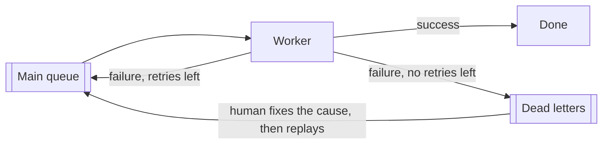
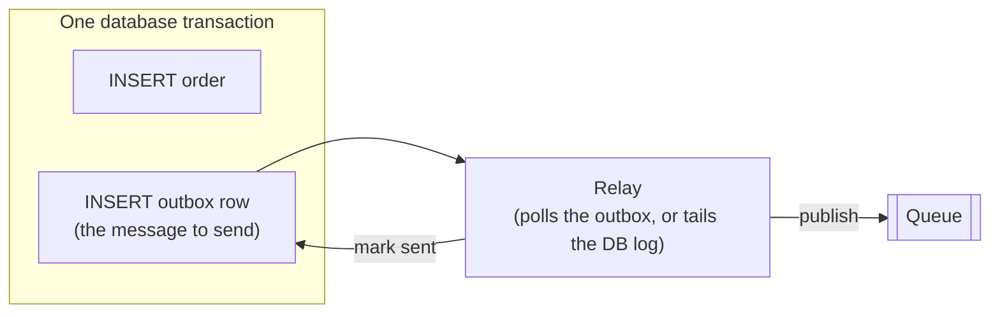
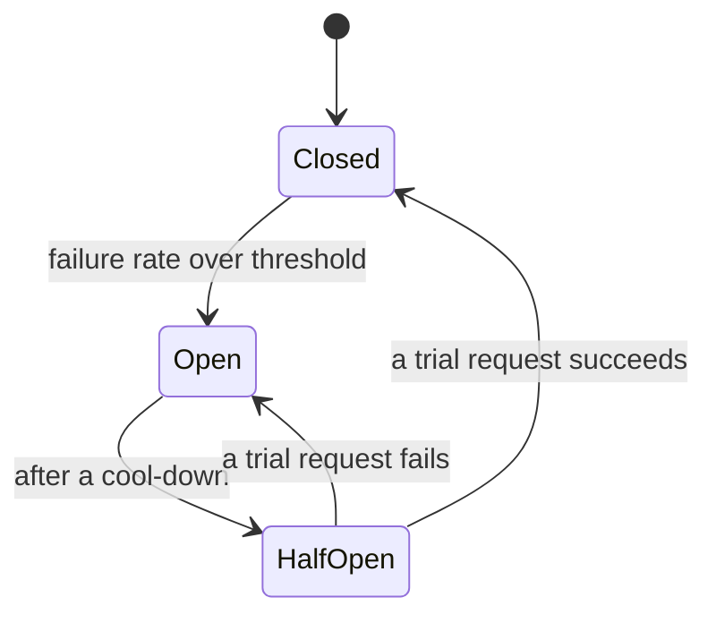

# Reliability patterns

The handful of ideas that make a system keep working when the things around it do not. Each one is used
in hookdeck-lite, except circuit breakers, which are background for a stretch goal.

## Backoff and jitter

When a request fails for a temporary reason, you try again. The question is when.

**Retry immediately** and you hammer a service that is already struggling. **Retry at a fixed interval**
and you are either too aggressive during a long outage or too slow after a short blip.

**Exponential backoff** doubles the wait each time: 30 s, 1 min, 2 min, 4 min… Short problems are retried
quickly; long outages are probed less and less often. Add a **cap** so the wait does not grow without limit.

```ts
const ceiling = Math.min(capMs, baseMs * 2 ** (attempt - 1));
```

That is still not enough, and the reason is the most useful thing in this document.

### The thundering herd

Suppose a destination goes down at 12:00:00 and 1 000 deliveries fail within that second. With plain
exponential backoff, all 1 000 retry at 12:00:30. The destination, perhaps just restarting, receives
1 000 requests at once and falls over again. All 1 000 then retry together at 12:01:30. And so on.

The retries are **synchronized**: the clients failed together, so they compute the same delays and come
back together. Each wave is as large as the original burst. The backoff spaces the waves out but does
nothing about their height.

```
Without jitter (requests per second to the destination)

1000 |█              █                          █
     |█              █                          █
   0 +█--------------█--------------------------█---------> time
     12:00:00     12:00:30                   12:01:30

With full jitter

1000 |█
     |█
  40 |█▁▁▁▁▁▁▁▁▁▁▁▁▁▁▁▁▂▂▂▂▂▂▂▂▂▂▂▂▂▂▂▂▂▂▂▂▂▂▂▂▂▂▁▁▁▁▁▁▁▁
   0 +------------------------------------------------------> time
     12:00:00     12:00:30                   12:01:30
```

### Jitter

**Jitter** is deliberate randomness in the delay. Instead of everyone waiting exactly 30 s, everyone
waits a random time, so the retries arrive spread out.

There are a few flavours. **Full jitter** picks uniformly between zero and the exponential ceiling:

```ts
function computeBackoffDelay(attempt: number, random = Math.random): number {
  const ceiling = Math.min(capMs, baseMs * 2 ** (attempt - 1));
  return Math.floor(random() * ceiling);       // uniform in [0, ceiling)
}
```

With 1 000 failed deliveries and a 30 s ceiling, the retries arrive at about 33 per second for 30
seconds instead of 1 000 in one second. AWS's well-known analysis ("Exponential Backoff And Jitter")
compared the variants and found full jitter does the least total work for the same result.

The price is that an individual retry can come very soon (the random draw can be near zero), and the
average wait is half the ceiling. For load-spreading that is the right trade.

Passing `random` as a parameter is a testing trick: tests supply a fixed function and assert exact values.

### Retry-After

Sometimes the server tells you when to come back: `429 Too Many Requests` or `503 Service Unavailable`
with a `Retry-After: 120` header (seconds, or an HTTP date). A polite client waits at least that long.
A careful client also caps it, so a broken or hostile server cannot make it wait a year.

### When not to retry

Backoff is for failures that might go away: timeouts, connection errors, `5xx`, `429`. It is wrong for
failures that will not: `400`, `401`, `404`. Retrying those wastes hours and delays the moment a human
notices. Deciding which is which is called **classification**.

hookdeck-lite's formula, worked delay table, and classification table are in
[QUEUES.md](../QUEUES.md#backoff). The decision record is
[ADR-0006](../adr/0006-queues-backoff-classification.md).

## Dead-letter queues

Retrying forever is not an option: a message that can never succeed (a **poison message**) would be
retried until the end of time, consuming capacity. So retries have a limit. What happens to a message
that hits it?

Dropping it silently is the worst answer. The standard answer is a **dead-letter queue** (DLQ): a place
where messages that could not be processed are parked, so that

- they stop blocking or slowing healthy work,
- a human can see them and find out why,
- they can be **replayed** after the cause is fixed.



Brokers like RabbitMQ and SQS have DLQs built in. **BullMQ does not.** A job that exhausts its attempts
goes to the queue's `failed` set, which lives in Redis memory and is trimmed by retention settings. That
is fine for debugging and poor as a system of record.

hookdeck-lite makes the database row the dead letter: a `Delivery` with status `DEAD`. It is durable,
queryable, and shown in the dashboard. Replaying creates a new `Delivery` linked to the old one and
leaves the old one untouched, so the record of what happened is never rewritten.
See [ADR-0007](../adr/0007-dead-letter-and-replay.md).

Two habits worth keeping:

- **Alert on DLQ growth.** A dead letter nobody looks at is a lost message with extra steps.
- **Make replay safe.** Replayed messages are duplicates by definition, so consumers must be
  [idempotent](webhooks-101.md#idempotency).

## The outbox pattern

You often need to do two things together: change the database *and* tell another system (publish a
message, enqueue a job). These are two writes to two systems, and there is no transaction that spans both.

```ts
await db.orders.insert(order);        // 1
await queue.add('order.created', …);  // 2
```

- Crash between 1 and 2: the order exists, nobody is told. **Lost message.**
- Swap them, and crash between: a message about an order that does not exist. **Phantom message.**
- Wrap 2 in the database transaction: the queue is not part of the transaction, so a rollback after the
  enqueue leaves a phantom, and a failed enqueue aborts a valid order.

This is the **dual-write problem**.

The **transactional outbox** solves it by writing only to the database, twice, in one transaction:



Either both rows are committed or neither is. A separate **relay** process reads unsent outbox rows,
publishes them, and marks them sent. If the relay crashes after publishing and before marking, it
publishes again: at-least-once, so consumers must be idempotent. But nothing is ever lost or invented.

The costs are real: an extra table, a relay process to run and monitor, and either polling delay on
every message or change-data-capture infrastructure to avoid it.

### Outbox-lite

hookdeck-lite uses a slimmer version. The observation: the `Event` row already contains everything
needed to publish, and its `status` column can say whether publishing happened.

1. Insert the Event with `status = RECEIVED` (the durable write).
2. Try to enqueue directly (the fast path, no relay delay).
3. A **sweeper** periodically looks for Events still `RECEIVED` after 30 seconds and enqueues them.

The Event row is the outbox row, and the sweeper is the relay, used only for the leftovers. Because the
job id is the event id, enqueueing twice is harmless ([job IDs](bullmq-101.md#job-ids)).

| | Redis-only | Outbox-lite | Full outbox |
|---|---|---|---|
| Durable once acknowledged | No | Yes | Yes |
| Extra latency on the happy path | None | None beyond the insert | Relay delay |
| Extra infrastructure | None | A periodic query | Outbox table + relay |
| Recovery delay after a failed enqueue | Not applicable (lost) | Up to 45 s | Relay interval |

Full comparison and reasoning: [ADR-0004](../adr/0004-ingestion-durability.md). The flow is
[sequence diagram 6](../ARCHITECTURE.md#6-sweeper-recovering-an-event-that-was-never-enqueued).

## Circuit breakers

Background for stretch goal C1. Not implemented in the first version.

Backoff protects a destination from *one delivery's* retries. But if a destination is completely down and
500 new events arrive for it every minute, each one still makes a first attempt, waits for a 15-second
timeout, and occupies a worker slot while doing so. The destination gets no rest, and deliveries to
healthy destinations queue up behind the doomed ones.

A **circuit breaker** tracks the health of a dependency and stops calling it when it is clearly down.
The name comes from electrical breakers: when something is wrong, open the circuit.



- **Closed**: normal. Requests flow; failures are counted.
- **Open**: requests are not sent at all. They fail fast (or are postponed) without touching the destination.
- **Half-open**: after a cool-down, let one or a few trial requests through. Success closes the circuit;
  failure opens it again.

For hookdeck-lite, a breaker per destination would keep state in Redis (shared by all workers), and a
delivery job that finds the circuit open would be re-delayed without counting as an attempt. BullMQ
supports that: throwing `DelayedError` after `job.moveToDelayed()` does not increase `attemptsMade`.

What it buys: less wasted work, faster recovery for the destination, and isolation between tenants.
What it costs: more state, thresholds to tune, and a new way to be wrong (a breaker that opens too
eagerly delays good deliveries). That cost is why it is first on the [cut list](../PLAN.md#cut-list).

## Backpressure

A system has **backpressure** when a slow stage can make the stages before it slow down, instead of
letting work pile up without limit. Without it, a fast producer and a slow consumer end in an
out-of-memory crash or a queue that is hours behind.

Every queue hides this question: what happens when work arrives faster than it is done? The options are
few: buffer it (until memory runs out), drop it, slow the producer, or add capacity.

Where hookdeck-lite applies pressure, from the outside in:

| Point | Mechanism | Effect |
|---|---|---|
| Ingestion | Per-tenant [rate limit](#rate-limiting-algorithms), `429` + `Retry-After` | The provider slows down and retries later. Providers handle this well; it is the designed-for path |
| Ingestion | Body size limit, `413` | Bounds per-request cost |
| Queue | Redis `maxmemory-policy noeviction` | A full Redis rejects new jobs loudly instead of dropping old ones silently. Events stay safe in Postgres and the sweeper enqueues them later |
| Worker | `concurrency` | At most N deliveries in flight. Extra jobs wait in Redis, which is cheap because jobs hold only ids |
| Outbound | Timeout and response size cap | One slow or huge response cannot hold a slot or memory indefinitely |
| Outbound | Backoff, `Retry-After` | A struggling destination is contacted less |
| Stream | Bounded SSE buffer per client | A stalled browser tab is disconnected instead of growing a buffer |

The buffer that absorbs bursts is Postgres plus the Redis queue. It is large but not infinite, which is
why the limit at the front door matters.

A useful habit: for every queue or buffer you add, write down its maximum size and what happens when it
is reached.

## Rate limiting algorithms

A rate limiter answers "has this client made too many requests recently?" The algorithms differ in what
"recently" means.

**Fixed window.** Count requests per calendar window (each minute). Simple: one counter with an expiry.

```
limit 10/min      11:59:00 ─────────── 12:00:00 ─────────── 12:01:00
                              ██████████│██████████
                         10 requests at 11:59:59 and 10 more at 12:00:00
```

The flaw is at the boundary. A client can spend a whole window's allowance in the last second and
another in the first second of the next: twice the limit in two seconds.

**Sliding log.** Store the timestamp of every request (a Redis sorted set). To decide, delete entries
older than the window and count the rest. Exact, with no boundary effect. But memory and work grow with
the request rate: a limit of 100 000 per minute means up to 100 000 stored entries per client.

**Sliding-window counter.** A compromise. Keep two fixed-window counters, the current and the previous.
Estimate the sliding count by weighting the previous window by how much of it is still inside the last
60 seconds:

```
estimate = previous × (1 − elapsed / window) + current
```

Example: limit 100/min. The previous window had 80 requests. We are 15 s into the current one (25 %), and
it has 30 requests so far.

```
estimate = 80 × (1 − 0.25) + 30 = 60 + 30 = 90     → under 100, allowed
```

Two counters per client, constant work, and no boundary burst. The estimate assumes the previous
window's requests were evenly spread, which is slightly wrong but close enough for load protection.

**Token bucket.** A bucket holds up to B tokens and refills at R per second; each request takes one.
Allows bursts up to B while enforcing an average of R. Widely used; a little harder to explain as "N per
minute".

| | Memory per client | Exact | Boundary burst | Bursts by design |
|---|---|---|---|---|
| Fixed window | 1 counter | no | yes | no |
| Sliding log | 1 entry per request | yes | no | no |
| Sliding-window counter | 2 counters | approximately | no | no |
| Token bucket | 2 values | yes | no | yes |

Whatever the algorithm, the check-and-increment must be **atomic**, or concurrent requests slip through.
In Redis that means a [Lua script](bullmq-101.md#lua-scripts).

hookdeck-lite uses the sliding-window counter. The script is in
[SECURITY.md](../SECURITY.md#rate-limiting) and the comparison in [ADR-0010](../adr/0010-rate-limiting.md).

## Server-Sent Events

SSE is the simplest way for a server to push a stream of messages to a browser. It is a normal HTTP
response that never ends, with `Content-Type: text/event-stream`, in a small text format:

```
: this is a comment

event: delivery.attempted
data: {"deliveryId":"…","status":"RETRYING"}

event: event.received
data: {"eventId":"…"}

```

Each message is a few `field: value` lines followed by a blank line. `data` is the payload, `event` is an
optional type, and a line starting with `:` is a comment that clients ignore.

Compared with WebSockets: SSE is one-directional (server to client), text-only, and plain HTTP, so
existing auth, CORS, proxies, and load balancers work unchanged. WebSockets are bidirectional and need a
protocol upgrade. For "show me what is happening", SSE is enough.

### Keep-alive

A connection that carries no bytes for a while looks dead to the things in between. Proxies, load
balancers, and some browsers close idle connections after 30–120 seconds. If no events happen for a few
minutes, the stream would be cut even though nothing is wrong.

The fix is to send something small regularly. An SSE comment is ideal because clients ignore it:

```
: ping
```

hookdeck-lite sends one every 15 seconds. It also lets the server notice a client that has gone away,
because the write fails.

### In the browser

The built-in client is one line, and reconnects automatically:

```ts
const es = new EventSource('/api/v1/stream');
es.addEventListener('delivery.attempted', (e) => handle(JSON.parse(e.data)));
```

Its limitation: **`EventSource` cannot set request headers**, so it cannot send
`Authorization: Bearer …`. The alternatives are putting the credential in the URL (it ends up in logs),
using cookies, or reading the stream with `fetch`:

```ts
const res = await fetch(`${apiUrl}/api/v1/stream`, {
  headers: { Authorization: `Bearer ${apiKey}`, Accept: 'text/event-stream' },
  signal: abortController.signal,
});
const reader = res.body!.pipeThrough(new TextDecoderStream()).getReader();
// feed chunks to a parser (eventsource-parser) and handle each event;
// on error or end, wait with backoff and reconnect.
```

hookdeck-lite does the latter. With `fetch` you write the reconnect loop yourself.

### On the server

In NestJS an SSE endpoint returns an RxJS `Observable`; each emitted value becomes one message, and Nest
unsubscribes when the client disconnects:

```ts
@Sse('stream')
stream(@Req() req): Observable<MessageEvent> {
  const messages$ = this.streamHub.forTenant(req.tenantId).pipe(
    map((m) => ({ type: m.type, data: m })),
  );
  const pings$ = interval(15_000).pipe(map(() => ({ comment: 'ping' })));
  return merge(messages$, pings$);
}
```

SSE has a resume mechanism (`id:` fields and the `Last-Event-ID` header). It only helps if the server
can replay missed messages. Ours come from Redis pub/sub, which stores nothing, so the dashboard
refetches over REST after a reconnect instead. See [ADR-0011](../adr/0011-live-stream.md).
