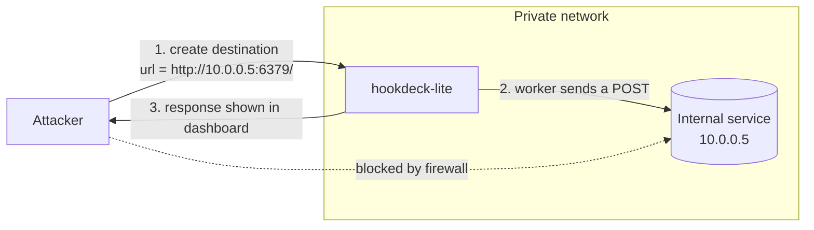
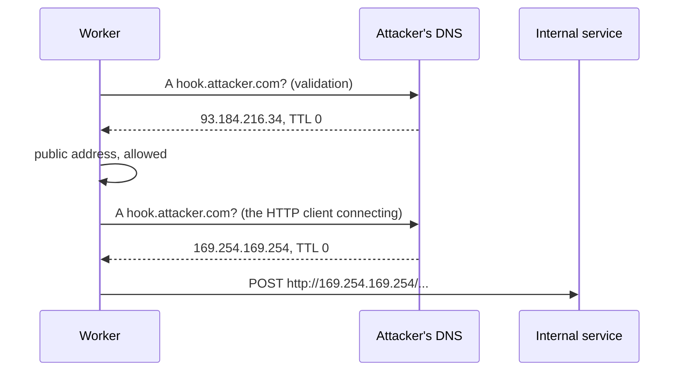

# SSRF and network security

hookdeck-lite's worker makes HTTP requests to URLs that users type into a form. That one sentence
describes one of the most exploited vulnerability classes on the web. This document explains the attack,
why the obvious defences fail, and what actually works. The project's rules are in
[SECURITY.md](../SECURITY.md#ssrf-protection).

## What SSRF is

**Server-side request forgery**: an attacker gets *your server* to send a request to a destination of
the attacker's choosing.

Why would that matter? The attacker can already send requests from their own machine. The difference is
**where your server sits**. It is inside your network. From there it can reach things the internet
cannot: databases, admin panels, internal APIs, other containers, the cloud provider's metadata service.
Those services often have no authentication, because "only internal machines can reach them."



A webhook gateway is close to a worst case:

- The user controls the URL entirely. That is the feature.
- The server sends a request with a body the user can influence (they can also post their own webhooks).
- The response status, headers, and part of the body are stored and **shown back to the user**. An SSRF
  where the attacker can read the response is far more dangerous than a blind one.

Even blind, SSRF is useful to an attacker: response times and error types reveal which internal hosts
and ports exist.

## Real incidents

**Capital One, 2019.** An attacker exploited an SSRF in a misconfigured web application firewall running
on AWS. They made it request the EC2 metadata endpoint, which returned temporary credentials for the
instance's IAM role. That role could read S3 buckets. Data on roughly 100 million customers was taken.
The bug was "the server will fetch a URL for you"; the damage came from what that server could reach.

**Shopify, 2018** (public bug-bounty report). A feature that fetched a URL to take a screenshot could be
pointed at the cloud metadata service of the infrastructure it ran on. The researcher obtained
credentials leading to root access on containers in that cluster. Shopify paid one of its largest
bounties at the time.

**Webhook features in general.** GitLab, among others, has shipped several fixes over the years for SSRF
through webhooks and integrations, including bypasses of its "block requests to the local network"
setting using DNS rebinding. The feature "send an HTTP request to a URL the user configured" is
recognised as an SSRF surface, which is why the Standard Webhooks spec has a section on it.

These are summaries from public reports; details are simplified.

## The cloud metadata endpoint

Every major cloud gives each virtual machine a special HTTP service at a fixed, non-routable address:

```
http://169.254.169.254/
```

From inside the machine, with no authentication, it returns information about the instance, including
**temporary credentials for the instance's cloud role**:

```
GET http://169.254.169.254/latest/meta-data/iam/security-credentials/my-role

{ "AccessKeyId": "ASIA…", "SecretAccessKey": "…", "Token": "…" }
```

With those, an attacker acts as your server against the cloud API: reading storage buckets, databases,
secrets. This is why `169.254.169.254` is the first address every SSRF attacker tries, and why it appears
by name in this project's blocklist.

`169.254.0.0/16` is the **link-local** range: addresses valid only on the local network segment. Cloud
providers picked an address there precisely because it never routes anywhere else.

Clouds have added defences (AWS's IMDSv2 requires a `PUT` to get a session token and a custom header,
which many SSRF bugs cannot produce). Those help. They are not a reason to allow the request.

## Why the obvious defences fail

**"Block `localhost` and `127.0.0.1` in the URL."** A string check on the hostname is defeated in a dozen
ways, covered under [encoding tricks](#encoding-tricks): other spellings of the same address, IPv6, and
above all the fact that **any domain name can point to any IP**. `evil.example.com` can have an A record
of `127.0.0.1`. The hostname tells you nothing; only the resolved address matters.

**"Resolve the hostname and check the IP when the user saves the destination."** Better. But DNS answers
are not permanent. The attacker saves `hook.attacker.com` while it points to a harmless public server,
passes the check, then changes the record to `10.0.0.5`. Every later delivery goes inside.

**"Then resolve and check before every request."** Closer, and still broken, because of how the check and
the request relate. That is the next section.

## DNS rebinding

Consider code that validates and then fetches:

```ts
const { address } = await dns.lookup(hostname);   // 1. resolve: 93.184.216.34 (public)
assertPublic(address);                            // 2. check: fine
await fetch(url);                                 // 3. fetch: resolves the hostname AGAIN
```

Step 3 does its own DNS lookup. The attacker controls the DNS server for their domain, and answers with
a TTL of zero so nothing is cached:



The name was **rebound** to a different address between the check and the use. This is a
time-of-check to time-of-use bug (TOCTOU): you validated one thing and used another.

It works because validation and connection each asked DNS, and DNS is under the attacker's control.

## IP pinning

The fix is to make sure the address you checked is the address you connect to. Resolve **once**, check
that result, and hand that exact address to the socket. There is no second lookup to lie to.

In Node, the networking layer accepts a custom `lookup` function, used in place of `dns.lookup` when a
socket is opened. So the validation can live *inside* the resolution the connection itself uses:

```ts
import dns from 'node:dns';
import https from 'node:https';

// LEARN: this lookup is the only DNS resolution for the connection. The socket connects to
// exactly the address we validate here, so a second, different DNS answer cannot be used.
function safeLookup(hostname, options, callback) {
  dns.lookup(hostname, { all: true }, (err, addresses) => {
    if (err) return callback(err);
    for (const { address } of addresses) {
      if (isBlocked(address)) {
        return callback(new SsrfBlockedError(hostname, address));
      }
    }
    const chosen = addresses[0];
    callback(null, chosen.address, chosen.family);   // pin
  });
}

https.request(url, { lookup: safeLookup, ... });
```

Two details that are easy to get wrong:

- **Keep the hostname for TLS.** You connect to the pinned IP, but the TLS handshake must still use the
  original hostname for SNI and certificate validation, and the `Host` header must be the original host.
  Passing a `lookup` function does this automatically. Rewriting the URL to `https://93.184.216.34/…`
  does not, and breaks certificate checks.
- **IP-literal hosts skip `lookup`.** For `http://127.0.0.1/` there is nothing to resolve, so the custom
  lookup never runs. Check literal addresses separately before connecting.

Checking **every** returned address, and rejecting if any is blocked, closes a related trick: a hostname
with both a public and a private record, hoping the client connects to the second.

## Validate at connect time

Put together, the principle is:

> The security check must be made on the connection you are about to open, not on the URL you were given.

| When you validate | What it catches | What it misses |
|---|---|---|
| When the URL is saved | Honest mistakes, obvious attacks | DNS changed later; rebinding |
| Before each request, separate lookup | DNS changed later | Rebinding (the second lookup differs) |
| **Inside the connection's own lookup** | All of the above | Redirects, unless you also refuse them |

hookdeck-lite validates when a destination is saved, as a courtesy that gives the user an immediate
error, and at every delivery inside the pinned lookup, which is the real control.

**Redirects** reopen the hole. A perfectly public URL can answer `302 Location: http://169.254.169.254/`.
If the HTTP client follows it, you have connected somewhere you never validated. Either validate each
hop with the same pinned lookup, or do what we do: never follow redirects. A webhook endpoint has no good
reason to redirect.

Application-level checks are one layer. In a real deployment add a network layer too: run the workers in
a subnet whose egress rules block internal ranges, or send outbound traffic through an egress proxy.
Then a bug in the application check is not enough to get in.

## Encoding tricks

Ways to write "127.0.0.1" that defeat string matching:

| Written as | Why it works |
|---|---|
| `http://2130706433/` | An IPv4 address is a 32-bit number; this is that number in decimal |
| `http://0x7f000001/`, `http://0x7f.0.0.1/` | Hexadecimal |
| `http://017700000001/`, `http://0177.0.0.1/` | Octal |
| `http://127.1/` | Short form; missing octets are filled in |
| `http://[::1]/` | IPv6 loopback |
| `http://[::ffff:127.0.0.1]/` | IPv4-mapped IPv6: an IPv4 address inside an IPv6 one |
| `http://[::ffff:7f00:1]/` | The same, in hex |
| `http://localhost.attacker.com/` → A record `127.0.0.1` | DNS |
| `http://attacker.com@127.0.0.1/` | The part before `@` is a username, not the host |
| `http://127.0.0.1.nip.io/` | Public DNS services that resolve to the embedded IP |

The defence is never to compare strings:

1. Parse the URL with the WHATWG `URL` class. It normalises decimal, hex, octal, and short IPv4 forms to
   dotted-decimal, and separates credentials from the host.
2. Resolve names to addresses.
3. Parse each address with a real IP library (`ipaddr.js`) and test **CIDR membership**.
4. For IPv6 addresses that embed an IPv4 address (IPv4-mapped, NAT64, 6to4), extract the IPv4 address and
   test that too.

The ranges to block are listed, with their purposes, in
[SECURITY.md](../SECURITY.md#blocked-ranges). Besides the private ranges (`10/8`, `172.16/12`,
`192.168/16`), loopback, and link-local, the list includes **CGNAT** (`100.64.0.0/10`, shared address
space used by ISPs and by some clouds and VPN tools for internal addressing) and IPv6 **unique local**
addresses (`fc00::/7`, the IPv6 counterpart of private ranges).

## The development allowlist

All of this blocks `localhost`, which is where the mock receiver runs during development, and
`mock-receiver`, its hostname inside docker-compose, which resolves to a private Docker address. Without
an exception, the demo cannot deliver anything.

`SSRF_ALLOWLIST` is a comma-separated list of hostnames that skip the IP-range check and nothing else:
scheme rules, no redirects, timeouts, and size caps still apply. It is set in `.env` for local work and
must be empty in production. An explicit, named exception in configuration is better than a
`if (NODE_ENV !== 'production')` branch buried in the code, because it is visible in review and in the
deployed environment.

## Encrypting secrets at rest

A related but separate topic: how the signing secrets are stored.

**Hashing vs encryption.** A hash is one-way: you can check a value against it but never get the value
back. That suits passwords and API keys, which you only compare. A webhook signing secret is different:
to compute an HMAC you need the secret itself. So it must be stored **reversibly**, which means
encryption with a key kept somewhere else.

**AES-256-GCM** is the standard choice. AES-256 is the cipher; GCM is a mode that also **authenticates**:
it produces a tag, and decryption fails if the ciphertext, the tag, or the associated data was altered.
A mode without authentication (CBC, CTR alone) will happily decrypt tampered data into garbage.

```ts
import { createCipheriv, createDecipheriv, randomBytes } from 'node:crypto';

function encrypt(plaintext: string, key: Buffer, aad: string) {
  const iv = randomBytes(12);                                  // 96-bit nonce, new every time
  const cipher = createCipheriv('aes-256-gcm', key, iv);
  cipher.setAAD(Buffer.from(aad));
  const ciphertext = Buffer.concat([cipher.update(plaintext, 'utf8'), cipher.final()]);
  const tag = cipher.getAuthTag();                             // 16 bytes
  return { iv, ciphertext, tag };
}

function decrypt({ iv, ciphertext, tag }, key: Buffer, aad: string) {
  const decipher = createDecipheriv('aes-256-gcm', key, iv);
  decipher.setAAD(Buffer.from(aad));
  decipher.setAuthTag(tag);
  return Buffer.concat([decipher.update(ciphertext), decipher.final()]).toString('utf8');  // throws if tampered
}
```

Three terms:

- **IV / nonce** ("number used once"): a value that must be different for every encryption with the same
  key. It is not secret and is stored next to the ciphertext. **Reusing a nonce with the same key in GCM
  is catastrophic**: it reveals relationships between plaintexts and lets an attacker forge tags. Twelve
  random bytes per encryption makes a collision practically impossible at our volumes.
- **Auth tag**: the integrity check. Without the right tag, `decipher.final()` throws.
- **AAD** (additional authenticated data): extra context that is authenticated but not encrypted. We use
  `"{tenantId}:{purpose}"`. If someone copies an encrypted secret from one tenant's row into another's,
  the AAD at decryption time differs and decryption fails. It binds a ciphertext to where it belongs.

**What this protects against, and what it does not.** Encryption at rest protects against someone who
gets the database without the key: a leaked backup, a SQL injection that dumps tables, a curious person
with read access. It does not protect against someone who has both the database and the application's
environment, since the key is there. That is why the master key lives in the deployment's secret store
and never in the repository or the database.

The envelope format and the rotation procedure are in [SECURITY.md](../SECURITY.md#secret-encryption).
