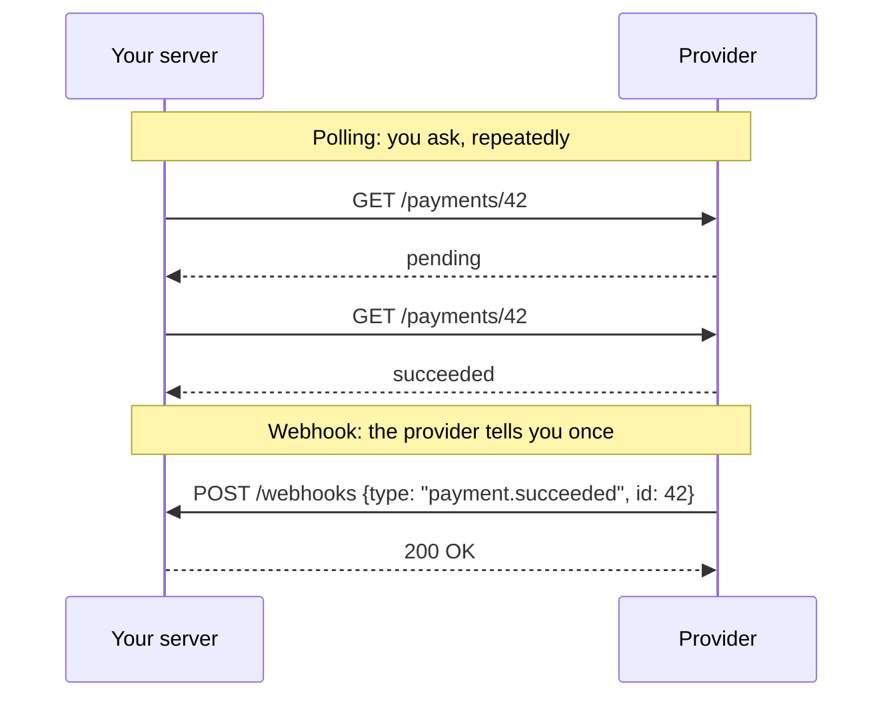
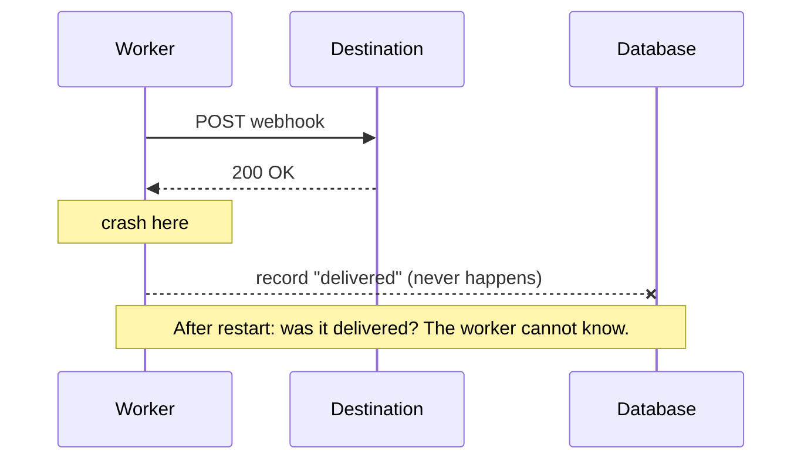

# Webhooks 101

For a TypeScript developer who has called plenty of REST APIs and has not yet had to receive webhooks in
anger. Each section explains one idea once; the spec docs link here.

## What a webhook is

A normal API call is you asking a question: "what is the status of payment 42?" A webhook is the other
side telling you something without being asked: "payment 42 just succeeded." Technically it is an HTTP
`POST` that the **provider** (Stripe, GitHub) sends to a URL that the **receiver** (you) registered.



The roles are reversed from what you are used to. **You are the server.** The provider is the client, and
you do not control when it calls, how often, how fast, or what it does when you fail.

hookdeck-lite sits in the middle. To providers it is the receiver. To your services it is the provider.
So this project has to get both sides right.

## Why providers retry

The provider cannot see inside your server. All it knows is the HTTP response:

- `2xx`: "the receiver has it." The provider is done.
- Anything else, or no answer within its timeout (usually 5–30 seconds): "I do not know whether the
  receiver has it." The only safe move is to send it again later.

So every serious provider retries, typically with growing delays for hours or days, then gives up.
Three consequences follow, and they shape this whole project:

1. **You will receive duplicates.** If your server processed the webhook but the response was lost or
   slow, the provider resends it.
2. **You will receive things out of order.** A retry of event 1 can arrive after event 2.
3. **Being slow is the same as being down.** If your handler takes 40 seconds, the provider sees a
   timeout, retries, and now you are doing the work twice while still being slow.

## Fast ACK

The fix for point 3 is to separate *accepting* the webhook from *processing* it.

```ts
// Slow: the provider waits while we do the work.
app.post('/webhooks', async (req, res) => {
  await chargeCustomer(req.body);       // 3 s
  await sendEmail(req.body);            // 2 s
  res.sendStatus(200);                  // provider may have timed out already
});

// Fast ACK: store it, answer, do the work later.
app.post('/webhooks', async (req, res) => {
  await db.events.insert(req.body);     // a few ms, durable
  await queue.add('process', { id });   // a few ms
  res.sendStatus(202);                  // "accepted"; processing happens in a worker
});
```

`202 Accepted` means "I have taken responsibility for this; processing is not finished." That is a
promise, so the event must be somewhere durable before you send it. In hookdeck-lite that place is
Postgres, and the reasoning is in [ADR-0004](../adr/0004-ingestion-durability.md). The ingestion flow is
[sequence diagram 1](../ARCHITECTURE.md#1-ingestion-with-fast-ack).

## Signatures

Your webhook URL is public. Anyone who learns it can `POST` a fake "payment succeeded". You need proof
that a request really came from the provider and was not changed on the way.

The standard tool is an **HMAC** (hash-based message authentication code). You and the provider share a
secret. The provider computes `HMAC-SHA256(secret, message)` and sends the result in a header. You
compute the same thing and compare. Without the secret, nobody can produce a matching value, and changing
one byte of the message changes the result completely.

```ts
import { createHmac } from 'node:crypto';

const signature = createHmac('sha256', secret).update(message).digest('hex');
```

An HMAC is not encryption. The body is still readable by anyone on the path (use HTTPS for that). It
gives you two things: **authenticity** (it came from someone with the secret) and **integrity** (it was
not modified).

## Raw body

Here is the bug nearly everyone hits once. The provider signed the exact bytes it sent:

```
{"amount":100,"currency":"EUR"}
```

Your framework parses the JSON into an object. You then do `JSON.stringify(req.body)` to verify:

```
{"amount":100,"currency":"EUR"}     <- same, by luck
```

But if the provider had sent `{"amount": 100, "currency": "EUR"}` (with spaces), or `100.0`, or keys in
another order, or a non-ASCII character escaped differently, your re-serialized string differs and the
HMAC does not match. **JSON has many byte representations of the same data, and the signature covers
bytes, not data.**

So you must keep the original bytes and verify against those:

```ts
// NestJS on Fastify: ask Nest to keep the raw buffer.
const app = await NestFactory.create<NestFastifyApplication>(AppModule, new FastifyAdapter(), {
  rawBody: true,
});

@Post('in/:sourceSlug')
ingest(@Req() req: RawBodyRequest<FastifyRequest>) {
  const raw: Buffer = req.rawBody!;     // verify the HMAC over this
  const parsed = req.body;              // use this for everything else
}
```

The same rule applies when we forward: hookdeck-lite stores the body as received and sends those bytes to
the destination, so the destination can verify our signature over them.

## Replay attacks

A signature proves a request was genuine *when it was made*. Suppose an attacker records one valid,
signed "credit account with €100" request (from a log, a proxy, a compromised machine). They can send
that exact request again tomorrow. The signature still verifies, because nothing changed.

The defence is to put a **timestamp inside the signed content** and reject old ones:

```
signed content = "{timestamp}.{body}"
accept only if |now - timestamp| <= tolerance (commonly 5 minutes)
```

The attacker cannot change the timestamp without breaking the signature, and the recorded request
expires after five minutes. The tolerance has to be more than zero because clocks differ and networks are
slow; it works in both directions so that a sender with a fast clock is also tolerated.

For the five minutes that remain, the second defence is [idempotency](#idempotency): remember the ids
you have seen.

`SIGNATURE_TOLERANCE_SECONDS` in this project is 300. The design is in
[SECURITY.md](../SECURITY.md#inbound-verification).

## Timing-safe comparison

You computed the expected signature. How do you compare it with the one in the header?

```ts
if (expected === received) { ... }     // do not do this
```

String comparison stops at the first character that differs. A guess whose first byte is right takes a
few nanoseconds longer to reject than one whose first byte is wrong. That difference is tiny, but an
attacker can send thousands of guesses and average it out, then recover the valid signature one byte at
a time. This is a **timing attack**.

The fix is a comparison that always takes the same time, whatever the inputs:

```ts
import { timingSafeEqual } from 'node:crypto';

const a = Buffer.from(expected, 'hex');
const b = Buffer.from(received, 'hex');
// timingSafeEqual throws if lengths differ, so check that first.
const ok = a.length === b.length && timingSafeEqual(a, b);
```

Checking the length first leaks only the length, which is public knowledge (SHA-256 is always 32 bytes).

## Idempotency

An operation is **idempotent** if doing it twice has the same effect as doing it once. "Set the order
status to paid" is idempotent. "Add €100 to the balance" is not.

Because duplicates are certain ([why providers retry](#why-providers-retry)), a webhook receiver must
make its processing idempotent. The usual way is an **idempotency key**: every event carries a unique id,
and you record the ids you have handled.

```ts
// A unique index turns "have I seen this?" into one atomic insert.
try {
  await db.processedEvents.insert({ id: webhookId });   // UNIQUE(id)
} catch (e) {
  if (isUniqueViolation(e)) return res.sendStatus(200); // seen it: acknowledge, do nothing
  throw e;
}
await handle(event);
```

Do not write `if (!(await seen(id))) { await handle(); await markSeen(id); }`. Two copies arriving
together would both pass the check. Let the database's unique constraint decide.

hookdeck-lite uses this idea in two places:

- **Inbound**: a unique index on `(sourceId, externalEventId)` makes a provider's retry a no-op.
  See [DATA-MODEL.md](../DATA-MODEL.md#prisma-schema-draft).
- **Outbound**: every request we send carries a stable `webhook-id`, so *your* receivers can do the same.
  See [ADR-0005](../adr/0005-at-least-once-delivery.md).

## Delivery guarantees

There are three promises a delivery system could make:

| Guarantee | Meaning | How it fails |
|---|---|---|
| **At-most-once** | Each message is delivered zero or one times | Messages can be lost |
| **At-least-once** | Each message is delivered one or more times | Messages can be duplicated |
| **Exactly-once** | Each message is delivered once | Cannot be achieved across a network boundary |

Why exactly-once is out of reach: sending a message and recording that you sent it are two steps, in two
systems.



After the crash you must either send again (possibly a duplicate) or not (possibly a loss). There is no
third option, and no ordering of the two steps removes the gap.

What people call "exactly-once" in practice is **at-least-once delivery plus idempotent processing**:
the sender may repeat itself, and the receiver ignores repeats using the message id. The effect is
exactly-once, built from two honest parts.

hookdeck-lite delivers at-least-once. Where duplicates can come from is listed in
[QUEUES.md](../QUEUES.md#delivery-processor).

## How Stripe and GitHub do it

Two real designs, to make the above concrete.

**Stripe**

- Header: `Stripe-Signature: t=1700000000,v1=5257a869e7ecebeda32affa62cdca3fa51cad7e77a0e56ff536d0ce8e108d8bd`
- Signed content: `{t}.{raw body}`, HMAC-SHA256, hex.
- Timestamp tolerance: 5 minutes by default in Stripe's libraries.
- Several `v1=` values can appear during secret rotation.
- Each event has an `id` (`evt_…`) to deduplicate on.
- Retries: for up to about three days with exponential backoff.
- Expects a `2xx` quickly and tells you to do your work asynchronously.

**GitHub**

- Header: `X-Hub-Signature-256: sha256=<hex>`.
- Signed content: the raw body only. **No timestamp**, so the signature alone gives no replay protection.
- `X-GitHub-Delivery` is a unique id per delivery, which you can deduplicate on.
- Expects a response within 10 seconds. It does not retry automatically; failed deliveries can be
  redelivered by hand or through the API.

Both sign the raw body with HMAC-SHA256 and give you an id. They differ in header format, in whether a
timestamp is signed, and in retry behaviour. That is why hookdeck-lite has verification *modes*:
`generic-hmac` with a prefix and hex encoding covers GitHub's scheme. Stripe's `t=…,v1=…` header would
need its own preset, which is out of scope ([PRD.md](../PRD.md#non-goals)).

These details are from the providers' public documentation and may have changed; check their docs before
relying on a specific number.

## Standard Webhooks

Every provider inventing its own headers means every receiver writing new verification code. The
[Standard Webhooks](https://www.standardwebhooks.com/) specification is an attempt to agree on one way.
hookdeck-lite uses it for everything it sends and accepts it as an inbound mode.

Three headers:

| Header | Content |
|---|---|
| `webhook-id` | Unique id of the message. **The same across retries.** Use it as the idempotency key |
| `webhook-timestamp` | Integer Unix seconds, the time of this send |
| `webhook-signature` | One or more signatures, space-separated, each `v1,<base64>` |

Signing:

```ts
import { createHmac } from 'node:crypto';

// The secret looks like "whsec_MfKQ9r8GKYqrTwjUPD8ILPZIo2LaLaSw". The key is the base64-decoded part.
const key = Buffer.from(secret.slice('whsec_'.length), 'base64');

const signedContent = `${webhookId}.${timestampSeconds}.${rawBody}`;
const signature = 'v1,' + createHmac('sha256', key).update(signedContent).digest('base64');
```

Things worth noticing:

- The id and timestamp are part of the signed content, so neither can be altered.
- The header can hold several signatures. During a secret rotation the sender signs with both the old and
  the new secret, and the receiver accepts if any matches. That allows rotation without downtime.
- Secrets are 24–64 random bytes, base64, prefixed `whsec_` so they are recognisable in config and in
  secret scanners.
- The spec recommends what this project implements: a timestamp tolerance, constant-time comparison,
  `2xx` as the only success, not following redirects, honoring `Retry-After`, timeouts of 15–30 seconds,
  and protection against [SSRF](ssrf-and-network-security.md#what-ssrf-is).
- There is an asymmetric variant (`v1a`, ed25519). We implement only `v1`.

One subtlety when you are the *sender* with retries: `webhook-timestamp` must be the time of **each
attempt**. If you signed once with the event's original time and retried two hours later, every receiver
with a five-minute tolerance would reject you.

The outbound design is in [SECURITY.md](../SECURITY.md#outbound-signing).

## Checklist: a good webhook receiver

If you remember nothing else:

1. Verify the signature over the **raw body**, with a **constant-time** comparison.
2. Check the **timestamp** against a tolerance.
3. **Store, then acknowledge** with a `2xx` fast. Process asynchronously.
4. **Deduplicate** on the message id with a unique constraint.
5. Do not assume **order**.
6. Return `2xx` for duplicates. They are not errors.
